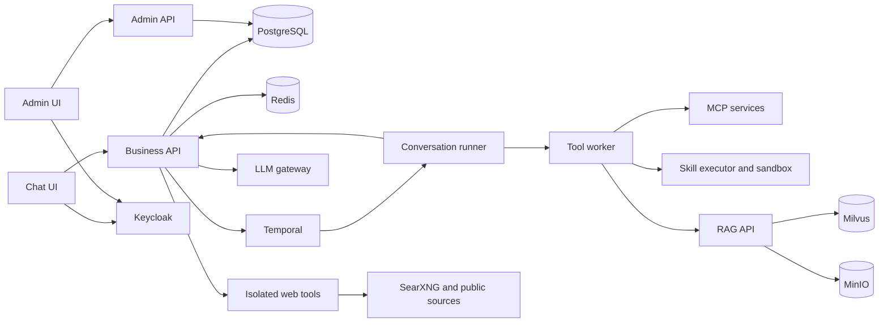

# AurumAI architecture

AurumAI is an organization-scoped AI application platform. Temporal coordinates
durable execution; PostgreSQL holds application state and permissions; a separate
conversation runner executes each conversation's workflow tree. The public source
retains established technical identifiers for deployment/replay compatibility.

## Components and data flow



| Component | Execution boundary |
|---|---|
| `main_business.py` | User chat, conversations, settings, runtime/internal APIs on port 8000 |
| `main_admin.py` | Skills/grants/agent and workflow authoring on port 8001 |
| `business-ui` | Chat/history/knowledge/workflow/question browser application |
| `admin-ui` | Separate browser application and Keycloak client for administration |
| `conversation-runner` | One isolated container/Pod per conversation; Temporal worker |
| `tool-worker` | Shared bounded skill/MCP execution activities |
| `skill-executor` | Creates and controls an ephemeral sandbox for a code-skill session |
| `rag-api` | Authorized document/search metadata and Milvus operations |
| `rag-worker` | Durable parsing, chunking, embedding/indexing operations |
| `web-tools` | Independent authenticated search/read adapter and outbound policy |
| Identity/data workers | Optional durable identity admission and lifecycle observers |

The backend's `ConversationWorkflow` is a typed client-side signal stub. Actual
execution is in `conversation-runner/src/workflows/conversation.py`. Signal
signatures must remain synchronized. Agent nodes do not create one runner each:
ConversationWorkflow → MultiAgentWorkflow → AgentWorkflow children all execute in
the same conversation runner.

## Chat lifecycle

1. Authenticate the browser, resolve the tenant and check `chat.send`/model access.
2. Admit a durable interaction turn and obtain an owned runner resource.
3. Send the turn signal to Temporal; the runner loads complete persistent history.
4. Execute streaming model/tool rounds through the backend gateway proxy.
5. Persist the final assistant response and publish safe terminal/progress events.
6. Optionally start a background evaluator configured with an explicit model.

The runner calls `http://backend:8000/v1/chat/completions` with its identity-only
session token. The API authorizes the actual current tenant/resource access and
proxies to `LLM_GATEWAY_URL` with the operator credential. Gateway requests remain
streaming; changing to `stream: false` or adding unsupported `response_format`
is not a compatible replacement for the `llm_call` activity.

Redis event channels are tenant-prefixed. SSE distinguishes assistant text/tool
presentation from durable turn/question snapshots. A final `done` event closes
chat transport even on cancellation/failure paths; optional evaluation is a later
score update, not a second assistant message.

History is ordered by durable turn/role structure, with a deterministic cursor
key rather than relying on timestamps alone. GET conversation pages use limit
1–200 (default 50), `hasMore` and message-UUID cursors. UI and runner load all pages
before replacing their history. Missing/repeated cursors and partial-page failure
must not silently publish an incomplete conversation.

## Authentication and authorization

Browser APIs validate Keycloak issuer/signature/audience. Business and admin clients
have different audiences (`business-ui` and `admin-ui`); one plane's token is not
accepted by the other. `org_admin` is the administrative role; membership is owned
by Keycloak, while capabilities/resource grants are owned by the platform.

Capabilities govern operations. Resource grants govern specific models, skills,
knowledge bases, agent/workflow resources as appropriate. Access is default-deny;
there is no parallel permission catalog or authoritative settings-based allowlist.
The organization default model/temperature are configuration, not access grants.
Same-organization administrative bypass does not bypass RLS or runtime-owner rules.

Service calls use `get_current_user_or_session` and `get_service_db_session`.
Browser-only `get_current_user`/`get_org_db_session` dependencies must not replace
those on routers consumed by runner/tool-worker. Service session tokens contain
identity only; privileges are resolved live, so grant revocation takes effect
between workflow steps. Do not store permission snapshots in a session token.

PostgreSQL runtime roles use FORCE ROW LEVEL SECURITY. Request/session dependencies
set `app.current_org_id` transaction context. Migration and lifecycle roles are
separate; ordinary API/RAG roles do not own schemas or receive archive privileges.
A connection reused for another organization must not inherit its previous context.

New organizations are provisioned on first verified login with the documented base
capabilities/model/global-skill grants. Existing organizations require a deliberate
provisioning preview/apply. Do not add capabilities implicitly to every new tenant.

Optional identity synchronization uses a durable inbox and generation fencing.
The signed `platform_groups_complete` claim distinguishes an explicitly empty
membership from an incomplete token claim. Worker outage gives bounded
`identity_sync_pending` admission for changed identities rather than stale privilege
acceptance. JWT/refresh tokens are not copied into inbox or Temporal history.

## Skills and isolated code

The common model wire format is `<tool_call>{...}</tool_call>`, parsed by the shared
runner parser. Tenant MCP uses SSE. Stdio is permitted only for explicitly
operator-global skills (`org_id=NULL`), not resources with an omitted owner.
Changing endpoint/transport must not carry a saved token to the new destination
without explicit replacement credentials.

The backend exposes camelCase JSON; tool-worker normalizes it to its snake_case
internal fields. Global or tenant ownership is explicit. A hidden attachment-search
skill is scoped to the exact conversation and its session claim.

Code skills are source ZIP bundles with SKILL.md and optional scripts. A bounded
CodeSkillSessionWorkflow opens an ephemeral sandbox, executes multiple model-driven
commands, feeds results back to the next round, and closes the session. Tenant code
never executes with the shared tool-worker's environment. Sandbox namespace/RBAC
are separate because `pods/exec` cannot be safely constrained by labels alone.

## Multi-agent workflows

Definitions and templates are persisted/versioned. Admission creates an immutable
execution snapshot of definitions/model dependencies. The snapshot fixes
configuration, not access: preparation, each node and synthesis recheck live grants.
Explicit picker selection has priority; opt-in classification can route an ordinary
turn only among accessible auto-routable definitions. Classification failures or
malformed/inaccessible selections fall back safely for an ordinary unselected turn.

The scheduler supports fixed graphs (up to 20 nodes, concurrency up to 4), lexical
ready order, conditional `on_success`/`on_failure` edges, AND-join and skip cascade.
Unhandled failures do not synthesize or persist a false successful assistant answer.
Only successful supervisor synthesis is exposed as the final answer. Node briefs,
internal outputs/thoughts and raw tool payloads are not public SSE progress.

Human confirmation is a durable owner-controlled signal with bounded waits and
runner activity renewal. Rejection, timeout and exact-run cancellation preserve
terminal durable status and do not cancel an unrelated later turn. Production
confirmation timeout is 1800 seconds; a test image can use a shorter explicit
65-second timeout without claiming production-deadline acceptance.

### Loops

Loop-back edges carry `is_loop_back` and `max_iterations` (2–20). The structural
graph remains acyclic after removing loop-back edges. A loop body is the intersection
of target descendants and tail ancestors. Nested/overlapping bodies, confirmation
nodes inside a body and fan-out from a non-tail body node are rejected.

When the tail outcome matches the edge condition below its iteration cap, capture
terminal body results, reset the body and persist `pending` immediately. Iteration
N+1 receives `context.previous_iteration` with every terminal result of iteration
N in stable node-key order. Completed entries carry output and allowed source IDs;
handled failures carry a stable error code. Current-pass `predecessor_outputs`
remain separate. Replace the snapshot at each loop-back; never accumulate older
passes. Accepted output bounds are 64 KiB per node and 512 KiB aggregate.

PostgreSQL reuses the latest node diagnostic row; Temporal child inputs/results
are the durable per-pass record. `loop-iteration-context-v1` is a permanent replay
marker. A wall-clock loop budget and nested/overlapping loops are not implemented.

### Templates, billing and diagnostics

Template capture/replace and copies are administrative, version-checked operations.
Copies use fresh definitions and explicit grants, defaulting to non-auto-routable.
Archiving a template does not mutate its existing copies. Model/skill/KB grants remain
live references, not permissions embedded in a template.

All node model calls use the same backend quota/usage ledger and initiating
user/organization correlation. Request limits and exact reported provider-token
usage are accounted over the current UTC month. Analytics totals for an arbitrary
reporting period must not be mistaken for monthly quota consumption.

Run/node diagnostics are organization-scoped and retained by configured policy.
Workflow progress contains allowlisted metadata only. Billing/usage/audit/history
are preserved by acceptance cleanup even when owned fixture metadata is removed.

## Durable questions

`ask_user` is server-owned/default-off. The backend sends its flag on each turn;
workflow code must not read a mutable runtime flag after import. Existing durable
questions remain readable/answerable/consumable/expirable after disabling new
reservations. Preserve `user-questions-v1` for old histories.

Limits are one pending question per execution, four concurrent questions per turn
and ten created questions per turn, with a real 3600-second deadline. Durable rows,
operation reservations and outbox dispatch make retry/consume identity explicit.
Causal consumption stores at least `answered_at` even if DB wall-clock time moves
backward. A lost SSE wake-up is recovered through durable snapshots/reconnection.

Answer races, revoke, cancel, late answer and next-turn lock release are distinct
checks. Worker restart acceptance answers while the exact owned worker is stopped,
then proves consume after that same worker returns; a short test does not prove
real one-hour idle/lease protection.

## Web tools and network isolation

Web search/read is a separate default-off capability (`web.access`) and adapter.
The runner cannot acquire direct unrestricted internet access instead. URL policy,
DNS/address pinning, redirects, bounded parsing, service credentials and kernel/CNI
outbound enforcement form different parts of the boundary.

Required deny ranges are synchronized between adapter, Docker guard and Helm.
`WEB_EGRESS_FORBIDDEN_CIDRS` adds operator restrictions consistently. IPv4/private
and IPv6/ULA TCP80/443 negatives require reachable positive controls: unavailable
IPv6 is incomplete coverage, not a successful deny test. Controlled public-looking
fixtures stay in isolated test networks; never add a production private allow-all.

Operations have durable reservations, bounded attempts/shared deadlines, current
pre-I/O and pre-persist authorization, and explicit cancellation. Nonretryable
429/4xx stay nonretryable across service boundaries. Late results after cancellation
or revocation must not persist sources or a false final response.

Source IDs remain conversation/execution-owned. Child web citations are validated
and propagated through workflow synthesis and loop feedback. Real provider/search
availability is independent from controlled policy/Temporal acceptance.

## Hermes Agent

Hermes Agent is an opt-in system agent with a runtime of its own (Docker only). A
conversation's turn goes from the runner to a `HermesSessionWorkflow` on tool-worker's
queue, and skill-executor starts one long-lived sandbox for the conversation, on its
own internal network. The sandbox's only way out is `hermes-egress`: the platform path
to the backend (model completions and the MCP bridge of platform tools), and CONNECT
tunnels up to the network mode the organization chose. Its token holds identity only
and has an audience of its own. Workspaces are snapshotted to object storage.

`hermes-preview` is the one thing browsers reach at a preview's origin. It streams
into the sandbox through skill-executor, and the sandbox gains no network for it.

See [the design](HERMES_AGENT.md), [the guide](guides/hermes-agent.md) and
[the settings](CONFIGURATION.md#hermes-agent).

## RAG, attachments and storage

Uploads go through the backend into MinIO, with explicit file/knowledge-base metadata
and direct conversation ownership. The RAG worker downloads/parses source files,
chunks and embeds them, and records index receipt/generation. Hybrid retrieval
combines Milvus search with the configured reranker. No RAG database/HTTP ports are
published by the ordinary profile solely for browser convenience.

Chat attachments create their own conversation-scoped KB/search skill. Knowledge
base deletion, upload, indexing and archive lifecycle admission share fences so
unresolved external writes cannot become detached/orphaned data. Preserve canonical
source ownership; a legacy ambiguous owner is a block, not an inferred global owner.

### Partitions and archive lifecycle

Conversations/messages/audit payloads use monthly UTC partitions and permanent UUID
identity registries. Foreign keys, unique/idempotency keys and FORCE RLS remain
valid across payload movement. pg_partman 5.5.0 is installed before migrations;
existing-table conversion requires backup and a writer-free maintenance window.

Archiving uses MinIO/Parquet with independent checks before purge. Default retention
is 180 days by last effective conversation activity, not creation age alone.
Archived conversations disappear from user UI/API; operator export/restore preserves
UUIDs, grants, typed payload, file checksums and original dense vectors. Billing and
usage registries remain. Restoring does not replay historical workflows or re-embed
content. A new restore generation fences old callbacks.

Observers preserve exact terminal receipts before Temporal history retention
expires, independently of the new-archive flag. Missing established history,
unknown children, incomplete provenance and ambiguous external-operation replies
block purge. See [archive operations](operations/data-archive.md).

## Runtime ownership and recovery

SessionManager binds/reuses runners through owned Redis records and labels. Docker
runs on the configured runner network, not the default network. Kubernetes verifies
release/conversation labels and UID before Pod deletion. Idle reaping and startup
cleanup must not remove an unrelated runtime.

Private acceptance journals record exact fixture identities and previous grants.
Before metadata/runtime removal, prove the exact Temporal tree: root input/queue,
saved run UUID, reciprocal parent/run/initiation and allowed child identities.
Terminate only verified RUNNING exact handles; preserve closed history. Missing
history, foreign children or a changed continue-as-new chain fail closed.

Questions/web Kubernetes wrappers retain cluster, release, Temporal namespace,
Compose dependencies, kubeconfig and journal on failed cleanup/verification.
Never replace these checks with prefix SQL or broad terminate/search. Browser flows
use Helm Ingress through loopback k3d NodePort mapping, not SSE port-forward.

## Frontend, configuration and observability

Both UIs use Next.js, TypeScript, Tailwind, TanStack Query and Keycloak browser
identity. Chat streams update owned message/tool identities; tool-call cards merge
by call ID rather than replacing the previous batch. Durable question reconnects
use bounded backoff and stop on permanent authorization denial/cancellation.

Server `RUNTIME_*` values are read per request and safely serialized into
`window.__RUNTIME_CONFIG__`. Do not replace them with build-time `NEXT_PUBLIC_*`
URLs. API/admin/source links support deployment origins without an image rebuild.
`/about` and local `/LICENSE` expose project licensing; source URLs are validated
HTTP(S) without URL credentials.

Langfuse/structured logs provide optional tracing and scores. Configure full-content
capture deliberately; internal prompts/documents may be sensitive. Never put tokens,
raw HTTP, browser storage state or private journals into public release reports.

New evaluation uses a durable configuration activity and requires an explicit
model. `evaluator-explicit-model-v1` protects histories recorded before this policy.
Mutable pool-mode session token/conversation settings are read in activities outside
the Temporal sandbox; importing settings into workflow code does not refresh them.

## API and deployment references

Business API exposes conversation/history/chat, user settings, documents and runtime
control. Admin API owns authoring/grants/models/analytics. Internal service endpoints
require session-aware authorization and scoped database dependencies. `/health` is
liveness; `/ready` checks required application dependencies. The
[API reference](reference/api.md) lists the routes of both planes.

See [configuration](CONFIGURATION.md), [Helm](../charts/aurum-ai/README.md),
[testing](TESTING.md), [service guides](../README.md#components) and current source
routers for complete request schemas. FastAPI documentation is not enabled by
turning off production auth or weakening RLS.

Authorization UI acceptance: `./smoke-test-authorization-ui.sh` verifies both Keycloak audiences and live resource grants. Run it exclusively with trace capture disabled; keep the private journal if exact-owned recovery fails. See the testing guide for prerequisites.

Knowledge UI acceptance: `./smoke-test-knowledge-ui.sh` verifies Admin UI → Business UI → MinIO/Temporal/Milvus lifecycle. It must not overlap organization mutations. It requires the current stack APP_SECRET_KEY, uses a private recovery journal and preserves it on cleanup failure.

For deterministic MCP/code acceptance, export the existing stack secret before applying the overlay:

```bash
export APP_SECRET_KEY=<current-stack-secret>
docker compose -f docker-compose.yml -f docker-compose.e2e.yml --profile mcp --profile skills-exec build backend backend-admin tool-worker mcp-everything mcp-fetch skill-executor test-gateway
docker compose -f docker-compose.yml -f docker-compose.e2e.yml --profile mcp --profile skills-exec up -d --no-build backend backend-admin tool-worker mcp-everything mcp-fetch skill-executor
# Run one exclusive acceptance scenario, then restore the ordinary gateway:
docker compose -f docker-compose.yml -f docker-compose.e2e.yml rm -sf test-gateway
docker compose -f docker-compose.yml up -d --force-recreate backend
```

Keep the exact-owned recovery journal if cleanup fails; restore infrastructure only as the scenario's recovery contract permits.
