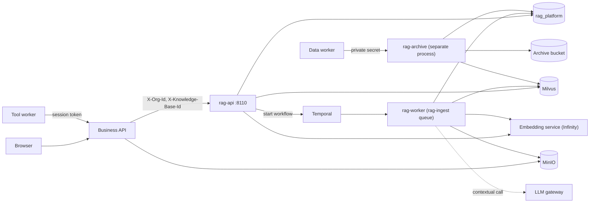
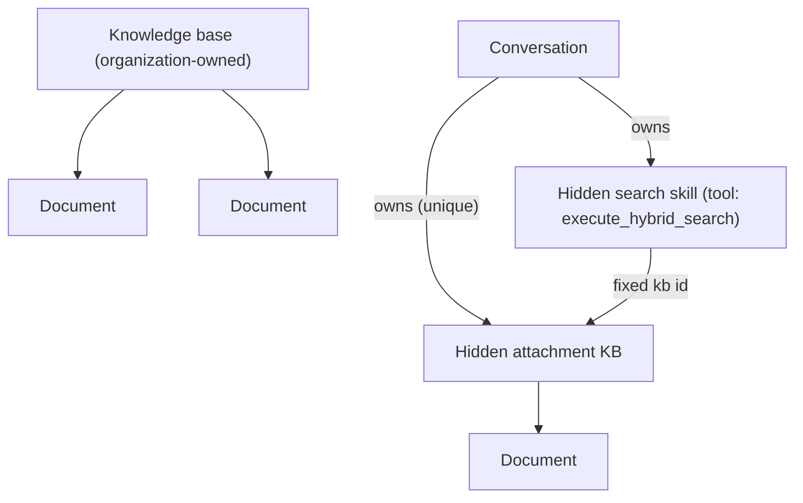
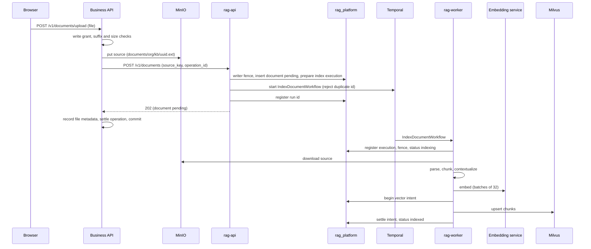
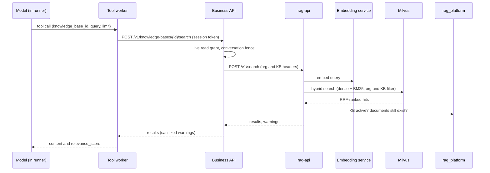

# AurumAI RAG architecture

This document describes how AurumAI stores, indexes and retrieves organization knowledge:
knowledge bases, uploaded documents, chat attachments, the ingestion pipeline, hybrid
retrieval, tenant isolation, consistency under failure, and the archive lifecycle. It is
written for architects and operators and describes the code on `main`. For the whole
platform see the [technical architecture](TECHNICAL_ARCHITECTURE.md); for the short rules
contributors must keep see the [architecture overview](ARCHITECTURE.md); for settings see
the [configuration reference](CONFIGURATION.md).

Contents:

1. [Summary](#1-summary)
2. [Components and trust boundaries](#2-components-and-trust-boundaries)
3. [Data model](#3-data-model)
4. [Tenancy and access control](#4-tenancy-and-access-control)
5. [Knowledge bases and their owners](#5-knowledge-bases-and-their-owners)
6. [Ingestion](#6-ingestion)
7. [Chunking and contextual retrieval](#7-chunking-and-contextual-retrieval)
8. [Retrieval](#8-retrieval)
9. [Consistency model and failure handling](#9-consistency-model-and-failure-handling)
10. [Archive, export and restore](#10-archive-export-and-restore)
11. [Operations and capacity](#11-operations-and-capacity)
12. [Design notes and known limits](#12-design-notes-and-known-limits)
13. [Source map](#13-source-map)

## 1. Summary

| Aspect | Design |
|---|---|
| Unit of knowledge | A **knowledge base** (KB) owned by an organization, holding **documents**. A hidden, per-conversation KB holds chat attachments. |
| Authoritative stores | PostgreSQL `aurum_ai` (KB metadata, grants, file metadata), PostgreSQL `rag_platform` (documents, ingestion state, lifecycle fences), MinIO (original files). |
| Derived store | Milvus: one collection, dense and sparse vectors per chunk. It can be rebuilt from the other stores. |
| Ingestion | Upload through the Business API into MinIO, then a durable Temporal workflow (`IndexDocumentWorkflow`) on the `rag-ingest` queue: parse, chunk, contextualize, embed, upsert. |
| Retrieval | Hybrid search: dense cosine and sparse BM25 in one Milvus call, fused by reciprocal-rank fusion (RRF), filtered against live PostgreSQL state and, when a reranker is configured, re-ordered by a cross-encoder. The model sees the larger parent window of each hit. |
| Access control | Live KB grants evaluated by the Business API; the RAG service is an internal trust boundary that applies the organization and KB it is given to every query; row-level security in `rag_platform`. |
| Consistency | Writes are fenced by a per-KB **generation**; every external side effect (a Milvus write or delete) is recorded as an **intent** before it happens and settled after; an uncertain outcome blocks further changes instead of being guessed. |
| Embeddings | One embedding model behind an OpenAI-style `/embeddings` endpoint (the `reranker` Compose service runs Infinity with `gte-Qwen2-1.5B-instruct`, 1536 dimensions). The Compose service named `reranker` only serves embeddings; cross-encoder reranking is a separate, optional service (`rag-rerank`, section 8.1). |

Three decisions explain most of the structure:

1. **The RAG service never decides who may see what.** It is told the organization and KB by
   the Business API, which has already evaluated the caller's live grant. This keeps one
   authorization implementation for the whole platform and keeps RAG simple.
2. **Search results are accepted only if PostgreSQL agrees.** Milvus is eventually
   consistent with deletes; every search re-checks that the KB is active and that each hit's
   document still exists.
3. **Archive safety drives the write protocol.** Because a KB can be archived and purged while
   indexing is in flight, writes carry a generation and external effects carry intents, so an
   archive can prove nothing is half-done before it deletes anything.

## 2. Components and trust boundaries



| Component | Role | Notable properties |
|---|---|---|
| Business API (`routers/documents.py`, `knowledge_bases.py`) | Public face: upload, list, delete, search; evaluates KB grants; stores sources; records file metadata | The only caller of `rag-api`; sends the organization and KB as headers. |
| `rag-api` | Internal document API and search | No port published to the browser; on the `rag-control-net` and `rag-net` networks only; own database role `rag_app`. |
| `rag-worker` | Temporal worker for `IndexDocumentWorkflow` | Reads sources from MinIO, runs Docling, calls the embedding service and Milvus. |
| Embedding service | `/embeddings` over HTTP | Same model for indexing and querying; configured by `*_RERANKER_URL` and `*_EMBEDDING_MODEL`. |
| Milvus (+ etcd) | Vector index | One collection; reachable only from the RAG services (and the archive process). |
| `rag-archive` | Private archive/export/restore process | A separate process and port, never mounted in the ordinary API, with its own secret and a `rag_lifecycle` database role. |
| MinIO | Original source files | Keys encode ownership: `documents/{org}/{kb}/{uuid}{.ext}`. |

The Tool worker and the runner do **not** talk to `rag-api`. A model's search goes
`tool worker → Business API → rag-api`, so every query passes through the platform's
authorization and audit paths.

## 3. Data model

### 3.1 `aurum_ai` (application database)

| Table | Content |
|---|---|
| `knowledge_bases` | `id`, `org_id`, `name` (unique per organization), `description`, `created_by`, and `owning_conversation_id` (unique, set only for the hidden attachment KB; cascades with the conversation). |
| `access_grants` | The KB grants (`resource_type = knowledge_base`, principal organization, group or user, permission `read` or `write`). |
| `file_metadata` | One row per stored source: `storage_key`, filename, content type, size, uploader, `document_id`, and `owning_conversation_id` for attachments. A partial index serves the conversation-owned lookups. |
| `skills` | For attachments: a hidden skill of type `tool` bound to the `execute_hybrid_search` activity with the KB id fixed as a constant in its input schema, owned by the conversation. |
| `conversation_operations` | Lifecycle operation receipts for document create, upload and delete (`document_create`, `document_upload`, `document_delete`) on conversation-owned KBs. |

### 3.2 `rag_platform` (RAG database)

| Table | Purpose |
|---|---|
| `documents` | `id`, `org_id`, `knowledge_base_id`, `title`, inline `content` **or** `source_key` plus `source_filename`, `parsed_markdown` (cache of the parse), `status` (`pending`, `indexing`, `indexed`, `failed`), `error`, `chunk_count`, `uncontextualized_chunks` and `truncated_chunks` (how the finished document differs from the ideal, see sections 6.4 and 7), timestamps. |
| `rag_kb_lifecycle` | One row per KB: `state` (`active`, `archiving`, `archived`, `restore_pending`), `generation`, `archive_id`, `provenance_complete`. The fence. |
| `rag_index_executions` | One row per indexing operation: operation id (idempotency key), document, generation, the exact Temporal `workflow_id`, `run_id`, task queue, terminal status and close time. |
| `rag_external_operations` | Intents for Milvus writes and deletes (`vector_upsert`, `vector_delete`) with a `settled` flag. |
| `rag_archive_jobs`, `rag_archive_steps` | The archive saga state and its step receipts. |

All of the lifecycle tables have `FORCE ROW LEVEL SECURITY` with a tenant policy on
`app.current_org_id`. `documents` is guarded by a trigger that makes `(id, org_id,
knowledge_base_id)` immutable and, for ordinary roles, requires the writer fence to pass
on every insert, update and delete. Privileged functions are `SECURITY DEFINER` with
pinned `search_path`, owned by an isolated schema-owner role; the runtime role `rag_app` can
read the lifecycle tables but changes them only through those functions.

### 3.3 Milvus collection

A single collection (`milvus_collection`, default `documents`) holds every tenant's chunks:

| Field | Type | Notes |
|---|---|---|
| `pk` | VARCHAR(128), primary | `{document_id}:{chunk_index}`: deterministic, so a retried upsert overwrites instead of duplicating |
| `org_id` | VARCHAR(64), **partition key** | Milvus groups data by organization, which keeps per-tenant filtered searches from scanning other tenants' segments |
| `knowledge_base_id`, `document_id` | VARCHAR | Filter and delete keys |
| `chunk_index` | INT64 | Position in the document |
| `content` | VARCHAR(65535), analyzer enabled | The indexed (contextualized) text; feeds the BM25 function |
| `dense` | FLOAT_VECTOR(`embedding_dim`) | Default 1536; index `AUTOINDEX`, metric `COSINE` |
| `sparse` | SPARSE_FLOAT_VECTOR | Generated by a Milvus BM25 function from `content`; index `SPARSE_INVERTED_INDEX`, metric `BM25` |
| `parent_content`, `acl_json`, `document_title` | dynamic fields | The window shown to the model; the ACL list (see 4.4); the title |

The service verifies at boot that an existing collection has the required fields. A
collection created before `knowledge_base_id` existed is reported as an error: its chunks
are invisible to filtered search until the collection is dropped and every document is
re-indexed.

### 3.4 Object keys

* Knowledge-base documents: `documents/{org_id}/{knowledge_base_id}/{uuid}{suffix}`. The key
  is assigned by the server; the RAG service accepts a `source_key` only if it matches this
  exact pattern for the organization and KB it was told about (`owns_source`). A legacy or
  shared key is not considered owned and is never purged by inference.
* Conversation attachments use the same pattern with the hidden KB's id.

## 4. Tenancy and access control

Every request passes five independent layers; a flaw in one is not enough to cross a
tenant boundary.

| Layer | Where | What it enforces |
|---|---|---|
| 1. Capability and grant | Business API (`_require_knowledge_access`) | `workspace.knowledge.create` for creating; a live `read` grant for list, get and search, a live `write` grant for upload and delete. Administrators are bounded by their own organization. |
| 2. Conversation fence | Business API | For a conversation-owned KB the owning conversation must be live and, for a runner's token, on the token's generation; a frozen conversation hides the KB (`404` for reads). |
| 3. Canonical scope | `rag-api` | The organization and KB come from headers set by the Business API; a body that names a different KB is rejected (`422`); a `source_key` outside the pattern is rejected. |
| 4. Row-level security | `rag_platform` | Every query runs under `app.current_org_id`; lifecycle tables are `FORCE` RLS. |
| 5. Vector filter and live check | Milvus and `rag-api` | Every search filters on `org_id` and `knowledge_base_id`; results are then restricted to documents that exist in PostgreSQL in a KB whose lifecycle state is `active`. |

Callers authenticated by a **session token** (a runner or tool worker) reach search through
the same `get_current_user_or_session` route, so a model's search is authorized for the
**person** the conversation belongs to, against current grants, not against a snapshot
taken when the agent was configured. Revoking a KB grant stops the next search, including
inside a running turn.

### 4.1 What the model can name

For an ordinary KB the model calls a search skill with a `knowledge_base_id` argument; the
backend checks the caller's grant on **that** id at search time, so a model that invents or
is tricked into another KB's id is refused. For attachments the hidden skill's schema pins
the id with a constant, and the grants it relies on belong to the conversation's owner.

### 4.2 Result shaping

The Business API returns only `results` and a sanitized `warnings` field: when the RAG
service reports any degradation the caller sees a fixed generic string, not provider or
infrastructure detail. The tool worker forwards only each hit's `content` and
`relevance_score` to the model.

### 4.3 Roles in `rag_platform`

`rag_app` (API and worker) cannot create objects in the schema and has read access to
lifecycle tables; `rag_lifecycle` (the archive process only) can modify them;
`rag_schema_owner` owns the tables and functions and never logs in. The ordinary
RAG API and the archive process therefore hold different credentials, and archive powers are
unreachable from any route the Business API calls.

### 4.4 Document-level ACLs are not used

Every chunk stores an `acl_json` list, and the hybrid search function can filter on it,
but the platform deliberately **does not** enforce per-document ACLs: no caller passes an
ACL. Access is decided at KB granularity (section 4, layer 1). Splitting content that has
different audiences into separate knowledge bases is the supported way to scope it.

## 5. Knowledge bases and their owners



**Ordinary KBs** are created and filled by users with `workspace.knowledge.create` in the
chat application; the Admin application decides who can use each KB (grants). Names are
unique per organization. The model searches a KB through a skill of type `tool` whose
`activity_name` is `execute_hybrid_search` (the attachment feature creates one automatically,
see below); an agent definition lists the KBs it may use, and the runner puts their ids and
names in the agent's prompt so the model can pass the right `knowledge_base_id`.

**Attachment KBs** are created lazily when a user attaches a file to a conversation. The
first attachment creates, in one transaction, the hidden KB (named
`__conversation_attachments__{conversation_id}`, excluded from every list), a hidden search
skill that fixes the KB id, and two provisioning grants for the conversation's owner (write
on the KB, read on the skill). Later attachments reuse them. Everything cascades with the
conversation. Because the KB's identity is tied to the conversation, deleting, archiving or
restoring the conversation fences the KB with it.

**Locks.** Writes to a KB take a row lock on it (`lock_for_write`) before the grant check,
so concurrent upload, delete and archive admission serialize on one KB rather than
interleaving.

## 6. Ingestion



### 6.1 Admission (Business API)

* **Accepted types:** `.pdf`, `.docx`, `.doc`, `.pptx`, `.html`, `.htm`, `.md`, `.txt`.
  Anything else is `415`. The size limit is 25 MB (`413`), an empty file is `422`. The file
  is read into memory under the limit and stored with a server-assigned key.
* **Order matters.** The source is stored first, then the document is created in `rag-api`,
  then the metadata row is written. A lost reply from `rag-api` leaves the stored source in
  place on purpose: deleting it could race a worker that already accepted the document.
  Cleanup of such orphans is an explicit, retryable operation, never an inference.
* **Inline text** (`POST /v1/documents` with `content`) is accepted up to 2 MB
  (`document_max_content_bytes`) and stored in the `documents` row; exactly one of `content`
  and `source_key` must be given.
* **Chat attachments** go through the same function after the hidden KB exists.

### 6.2 `rag-api` creates the document and starts the workflow

1. It takes the **writer fence**, which returns the KB's current generation or fails with
   `rag_frozen` (`409`) if the KB is archiving or archived.
2. It computes the operation id (supplied by the caller for idempotent retries) and the
   workflow id `rag-index-{document_id}-{operation_id}`.
3. A repeated request with the same operation id returns the **same** document: the stored
   title, content, source key and filename must match (else `409 rag_operation_payload_conflict`),
   and the generation must be unchanged (else `409 rag_operation_generation_conflict`).
4. A new document is inserted `pending` and an execution row is prepared in the same
   transaction.
5. After commit the workflow is started with `REJECT_DUPLICATE`. If the start succeeded but
   the reply was lost, a retry does not start again: it **verifies the exact workflow
   history** (below) and adopts its run id. If Temporal's history has been retired, a missing
   history never means "start again".
6. The run id is registered; any failure here returns `503 rag_index_start_unsettled` and the
   intent stays durable for reconciliation.

### 6.3 The workflow

`IndexDocumentWorkflow(document_id, org_id, knowledge_base_id, generation, operation_id)`
runs two kinds of activity, each with bounded retries:

* `register_index_execution` (30 s, 3 attempts): records the exact workflow and run identity
  in `rag_index_executions`. Gated by the replay marker `rag-lifecycle-v1`, so histories
  from before this activity existed still replay.
* `index_document` (10 minutes, heartbeat 1 minute, 3 attempts): the whole pipeline.
* On a final failure, `mark_document_failed` sets `status = failed` and a short error and
  re-raises.

### 6.4 The `index_document` activity

1. Reads the document under the **writer fence** at the workflow's generation. A missing
   document is a non-retryable failure.
2. If the document has a `source_key` and no cached `parsed_markdown`, downloads the object
   and parses it. **Docling** handles PDF, Word, PowerPoint, HTML and Markdown; plain text
   is read directly. The parse is cached in `documents.parsed_markdown` so a retry or a
   later re-index does not repeat the download and the (expensive) parse.
   Unconfigured storage, an empty file or a parser that produces no text are non-retryable.
3. Sets `status = indexing`, then runs ingestion (chunk, contextualize, embed, upsert).
4. Writes `status = indexed`, the number of chunks **actually upserted** and the two counts of
   section 7 (`uncontextualized_chunks`, `truncated_chunks`). If Milvus
   reported a partial failure the activity raises, so Temporal retries it (up to three
   attempts) and, failing that, the document is marked `failed`: a document is never shown
   as indexed when its vectors are missing.

### 6.5 Idempotency summary

| Concern | Mechanism |
|---|---|
| Client retries a create | Same `operation_id` returns the same document; payload mismatch is a `409` |
| Workflow start lost | Deterministic workflow id plus exact-history verification; never restart |
| Activity retried | Deterministic chunk primary keys make the Milvus upsert overwrite |
| Parse repeated | Cached in `parsed_markdown` |
| Stale run after delete or archive | Generation fence rejects its writes |

## 7. Chunking and contextual retrieval

The indexing strategy is **sentence window (small-to-big)**:

* Text is split into sentences. **Each sentence is a chunk**: it is the unit that is
  embedded and matched, which gives precise retrieval.
* Each chunk also carries a **parent window**: a run of consecutive sentences grouped up to
  `chunk_size` tokens (default 1000; tokens are estimated at about 4 characters), with an
  overlap of three sentences between windows. The parent window is what the model receives
  when the chunk is retrieved, which gives context. Hits from the same window share it.
* A document produces at most `max_chunks_per_document` chunks (default 2000); beyond that
  the tail is dropped, because each chunk can cost a model call. The drop is logged
  (`rag_document_truncated`) and the number of dropped chunks is stored on the document
  (`truncated_chunks`), so a partly indexed document is visible in the knowledge-base page.

**Contextual retrieval** (optional, `contextual_retrieval_enabled`, default on): for each
chunk the worker asks a model for a one- or two-sentence description of where the chunk sits
in the document (title plus the document's first 1200 characters plus the chunk), at
temperature 0 and at most 120 output tokens, 10 calls in flight at a time. The description
is prepended to the chunk, and the **combined text is what is embedded and what feeds the
BM25 function**, so both retrieval legs benefit. Failure is soft by design: on any error
the chunk is indexed without context. It is **counted**, not silent: the worker logs
`contextual_retrieval_degraded` with the number of affected chunks per document, stores it as
`uncontextualized_chunks` and the knowledge-base page shows a notice on the document. This means an air-gapped or unconfigured gateway does
not break ingestion; look at the per-document counts (and the `contextual_retrieval` line the
worker logs at start, which shows whether it is enabled and against which gateway) when recall
looks poor. The call goes
to `*_LLM_GATEWAY_URL` with `contextual_model`; in the default Compose stack it points at the
backend's protected endpoint, which the worker has no token for, so contextualization is
effectively off until a gateway is configured (the gateway overlay does this).

**Embedding.** Chunks are embedded in batches of `embed_batch_size` (32) by the embedding
service with a 120 s timeout per call; the dimension must equal `embedding_dim` or the
chunk fails validation.

**Heartbeats** are sent during contextualization and between stages so a long document does
not trip the activity's heartbeat timeout.

## 8. Retrieval



1. **Authorize.** The Business API evaluates the caller's live read grant on the KB (and the
   conversation fence for conversation-owned KBs). Timeouts: tool worker to backend 60 s,
   backend to `rag-api` 30 s.
2. **Embed.** `rag-api` embeds the query with the same model used for indexing, with a read
   timeout of `search_embedding_timeout_seconds` (default 10 s: a CPU-only model under memory
   pressure may need more on its first query after idling).
3. **Hybrid search.** One Milvus `hybrid_search` call with two requests, both filtered by
   `org_id == … and knowledge_base_id == …`: a dense request (cosine) and a sparse request
   (BM25 over `content`). Each fetches four times the number of results asked for; they are
   fused with **reciprocal-rank fusion** (`k = 60`). Without a reranker the number asked for is
   `limit`; with one it is the candidate pool (`rerank_candidates`, default 30, never above
   `search_max_limit`).
4. **Clamp.** `limit` is clamped to `search_max_limit` (50), both in the API handler and
   in the search function, because it is formed by a model from skill arguments.
5. **Live filter.** Hits are kept only if the KB is `active` in `rag_kb_lifecycle` and the
   document id exists in `documents` for that organization and KB. This closes the window in
   which a delete has removed the row but Milvus still serves a chunk, and the window in which
   a cancelled indexing run lands a few chunks after the delete.
6. **Rerank (optional).** See 8.1.
7. **Shape.** At most `limit` hits are returned (the search function over-fetches, so the
   handler cuts the list; older versions could return up to twice the requested limit). Each hit
   carries the **parent window** as `content` (falling back to the indexed text), the indexed
   text, a `relevance_score` and metadata (document, KB, chunk index, title). The score is the
   fused rank score, or the reranker's score when reranking ran (then the fused score is kept as
   `fusion_score`); either is useful for ordering within one result set and is not a calibrated
   probability.

### 8.1 Cross-encoder reranking

Fusion gives a good candidate list; a cross-encoder reads the query and each passage together
and orders them more accurately. It is **off by default** and turned on by setting
`RAG_API_RERANK_URL`; the model is `RAG_API_RERANK_MODEL` (default `BAAI/bge-reranker-v2-m3`).
In Compose, start the `rerank` profile (service `rag-rerank`, the same Infinity image as the
embedding service) and set `RAG_API_RERANK_URL=http://rag-rerank:7997`.

What happens, after the live filter (so no time is spent on deleted documents):

1. Hits that share a parent window (same document, same text) are collapsed to one passage;
   otherwise the model would read the same window several times.
2. At most `rerank_candidates` passages, each cut to `rerank_max_chars` (2000) characters, are
   sent to `POST {rerank_url}/rerank` in a single request with a `rerank_timeout_seconds` (10 s)
   bound.
3. The response must score every passage exactly once; anything else is treated as a failure.
4. The passages are ordered by score and the best `limit` are returned.

**Reranking never makes a search fail.** If the service is down, slow or answers badly, the
search returns the fusion order (still limited to `limit`, with duplicates collapsed) and a
warning; the Business API reduces any warning to a fixed generic string for the caller, and the
cause is logged as `rerank_unavailable`. The cost of enabling it is one extra request per
search (the cross-encoder scores up to 30 passages), so latency rises by the reranker's
inference time; run it on suitable hardware, and size `rerank_candidates` against that.

Failure behaviour: an embedding failure is `500 Embedding service unavailable`; an unreachable
RAG service is `503` at the backend; an empty or missing collection returns no results (and
initializes the collection). A search never returns content from another organization or
KB, and never returns a deleted document.

## 9. Consistency model and failure handling

PostgreSQL and Milvus cannot be updated atomically, and a Milvus RPC can succeed with its
reply lost. The design makes that uncertainty explicit and durable.

### 9.1 The generation fence

`rag_writer_fence(org, kb, generation)` is called at the start of every write path (API
create and delete, every worker step, the trigger on `documents`). It locks the KB's
lifecycle row and raises `rag_frozen` (`55000`) unless the KB is `active` and, when a
generation is given, still at that generation. The API maps it to `409 rag_frozen_or_unsettled`.
Archive and restore **advance the generation**, so any in-flight indexing workflow or
retried request carrying the old generation is rejected rather than writing into a KB that
has moved on.

### 9.2 Intents for external effects

Before a Milvus write or delete, `rag_begin_external` records a `vector_upsert` or
`vector_delete` row (refusing if another intent for the same document is unsettled); after
the RPC returns, `rag_settle_external` marks it settled. If the process dies, the RPC times
out or the call is cancelled, the row stays **unsettled**, and from then on:

* further writes to that document are refused (`rag_external_uncertain`);
* archive of that KB is blocked (`external_operation_unsettled`).

The Milvus mutation path itself is hardened to make "exactly one raw RPC" true: it bypasses
the SDK's retry wrappers, disables gRPC core retries, bounds the RPC (15 s) and asserts the
exact audited `pymilvus` version (2.6.17) at call time, refusing to run on any other.
An unknown or cancelled outcome propagates to the durable intent instead of being retried
blindly. (This is why `pymilvus` is pinned and why an upgrade needs a re-audit of
`mutation_transport.py`.)

### 9.3 Delete protocol

```
verify every open indexing execution of the document is closed (exact history)
fence → record vector_delete intent → delete chunks in Milvus → settle intent
fence → delete the document row
Business API then: delete the stored source and its file metadata (idempotent)
```

* If an indexing execution is not yet terminal, the delete is `409 rag_index_execution_unclosed`:
  a live run could otherwise upsert chunks after the delete.
* If the Milvus delete's outcome is unknown the response is `503 rag_vector_delete_unsettled`
  and the unsettled intent blocks later changes until reconciled.
* A retried delete after the document row is already gone is handled: the backend treats a
  `404` from `rag-api` as success when it still holds the metadata, so a half-finished delete
  can be completed. The source object is deleted only after ownership of its key is proven
  against `documents/{org}/{kb}/`.

### 9.4 Exact workflow identity

Reconciliation never relies on "latest workflow with this id". `verify_execution` loads the
recorded workflow's history (bounded: at most 10 000 events or 8 MiB) and requires that it
started exactly as the platform would have started it: same namespace and run id, first and
original run equal, no cron, no retry policy, no parent, no continue-as-new, no child
workflows, the expected workflow type and task queue, and an input equal to the expected
document, organization, KB, generation and operation. Anything else raises a blocking,
content-free code (for example `index_provenance_invalid`, `index_history_unavailable`). A
terminal event closes the execution row; this is what archive and delete wait for.

### 9.5 Failure matrix

| Failure | Result | Recovery |
|---|---|---|
| Embedding service down at search | `500`; no results | Restore the service; searches succeed again |
| Embedding service down at ingest | Activity retries (3), then `failed` | Fix and re-upload or re-index |
| Milvus down at ingest | Partial result raises, retried, then `failed` | Same; the intent stays unsettled only if the RPC outcome was unknown |
| Milvus outcome unknown (timeout, crash) | Intent unsettled; document writes and KB archive blocked | Operator reconciles; no silent retry |
| Worker crash mid-index | Temporal retries the activity; deterministic keys make upsert idempotent | Automatic |
| Lost workflow-start reply | `503 rag_index_start_unsettled`; retry adopts the exact run | Retry with the same operation id |
| Source stored, `rag-api` unreachable | Source kept, no document | Retry; orphan cleanup is explicit |
| KB archived while indexing | Old generation rejected | Re-upload after restore |
| Collection predates a required field | Boot error; filtered search returns nothing for old chunks | Drop the collection, re-index |

## 10. Archive, export and restore

Attachment knowledge bases are part of a conversation's archive (see
[data archive](operations/data-archive.md)); the RAG part of that saga runs in a **separate,
private process** (`main_archive.py`) that is never mounted in the ordinary API, is called
only by the data worker with an independent secret, and uses the `rag_lifecycle` role.

States of `rag_kb_lifecycle`: `active → archiving → archived → restore_pending → active`,
each transition advancing the generation.

* **Claim.** Under a row lock the KB moves `active → archiving` and a job records a bounded
  **inventory** of its documents (at most 10 000; larger fails with `inventory_limit`).
  The claim is refused, with a fixed content-free code, if: the generation does not match
  (`generation_conflict`), provenance is unknown for legacy documents
  (`legacy_provenance_unknown`, `document_provenance_unknown`), an external operation is
  unsettled (`external_operation_unsettled`), or an indexing execution is not closed
  (`index_execution_unclosed`). An empty hidden KB still gets a durable fence, so a later
  upload cannot slip in.
* **Observe.** Before anything is purged the archive observes the terminal state of every
  indexing execution using the exact-history verification of 9.4, so it can prove no worker
  can still write.
* **Export.** Document rows and **the original dense vectors** are written to verified,
  checksummed archive parts (16 MiB parts) in the archive bucket; sources are copied as their
  own verified objects. Restore therefore needs **no re-embedding and no re-parsing**, and
  returns bit-identical vectors.
* **Purge.** Only after verification, each step recorded as an intent and then `done`
  (`rag_archive_steps`) so a crash resumes exactly; Milvus chunks and source objects are
  removed through the same fenced, intent-recording path as an ordinary delete.
* **Restore.** `dry_run` validates; the real restore recreates rows, vectors and sources under
  a **new restore generation**, verifies them (including reading sources back), and only then
  publishes the KB as `active` (the `publish` step), so old callbacks and half-restored data are never visible.
* **Release.** Aborts an archive that is claimed or verified but not yet purged and returns the KB
  to `active` (`archive_release_unsafe` once purging has started), so a failed or cancelled
  archive does not leave a KB frozen.

The business side calls these through `rag_archive_client`; an attachment inspection is
read-only and does not promise that every claim or export check will pass.

## 11. Operations and capacity

### 11.1 Settings that shape behaviour

| Setting (prefix `RAG_API_` / `RAG_WORKER_`) | Default | Effect |
|---|---|---|
| `embedding_model`, `reranker_url` | `Alibaba-NLP/gte-Qwen2-1.5B-instruct`, `http://reranker:7997` | The model and endpoint (the endpoint serves embeddings) |
| `embedding_dim` | 1536 | Must match the model **and** the Milvus collection |
| `milvus_uri`, `milvus_collection` | `http://milvus:19530`, `documents` | Vector store |
| `search_max_limit` | 50 | Hard cap on results |
| `rerank_url` | empty (off) | Base URL of an Infinity-compatible `/rerank` service |
| `rerank_model` | `BAAI/bge-reranker-v2-m3` | Model name sent to the service |
| `rerank_candidates` | 30 | Passages scored per search (at most `search_max_limit`) |
| `rerank_timeout_seconds` | 10 | Bound on the rerank request |
| `rerank_max_chars` | 2000 | Passage length sent to the reranker |
| `search_embedding_timeout_seconds` | 10 | Query-embedding read timeout |
| `document_max_content_bytes` | 2 MiB | Inline text cap |
| `chunk_size` | 1000 | Parent window size, in estimated tokens |
| `embed_batch_size` | 32 | Embedding request size |
| `max_chunks_per_document` | 2000 | Bounds contextual calls per document |
| `contextual_retrieval_enabled`, `contextual_model`, `llm_gateway_url` | on, `gpt-4o-mini`, backend URL | Contextual retrieval |
| `ingest_task_queue` | `rag-ingest` | Worker queue |
| Business API `DOCUMENT_UPLOAD_MAX_BYTES`, `DOCUMENT_UPLOAD_ALLOWED_SUFFIXES` | 25 MB, see 6.1 | Upload admission |

### 11.2 Sizing and scaling

* **Search** is one embedding call plus one Milvus hybrid query plus two small PostgreSQL
  reads. Latency is dominated by the embedding service; run it on suitable hardware (a
  1.5B-parameter embedding model on CPU is slow for the first query after idle).
* **Ingestion** scales with `rag-worker` replicas on the `rag-ingest` queue. The cost drivers
  are Docling parsing (CPU, memory), one contextualization model call per chunk (up to 2000
  per document, 10 in flight) and embedding throughput. Large documents are bounded by the
  chunk cap and the activity timeout.
* **Milvus** is single-collection with an `org_id` partition key; very many small tenants
  and very large tenants both work, but a single huge tenant's filtered searches share
  segments with itself only.
* **Connections.** `rag-api` and `rag-worker` have their own SQLAlchemy engines against
  `rag_platform`; count them in the PostgreSQL connection budget of the
  [operations guide](guides/operations.md#database-connections).

### 11.3 Changing the embedding model or dimension

Vectors from different models or dimensions are not comparable. Changing `embedding_model`
or `embedding_dim` requires dropping the collection and re-indexing every document (the
cached `parsed_markdown` avoids repeating the parse, but contextualization and embedding run
again). There is no in-place migration tool. Plan the change as a maintenance window.

### 11.4 Backup and recovery

PostgreSQL `rag_platform` and `aurum_ai` and the MinIO business bucket are the sources of
truth; Milvus is derived. After a restore, a missing or empty collection is rebuilt by
re-indexing from the stored sources. See
[backup and recovery](operations/backup-recovery.md).

### 11.5 Networks and air-gapped installs

`rag-api`, the worker and Milvus sit on `rag-net` and `rag-control-net`; no RAG database or
HTTP port is published for browser convenience. The embedding service downloads its model
weights from a model hub on first start, and Docling can need substantial model artifacts;
an [air-gapped](AIR_GAPPED.md) install must provide them from prepared artifacts and should
treat contextual retrieval as off unless a local gateway is configured.

### 11.6 Observability

`rag-api` exposes Prometheus metrics at `/metrics` and `/health`; traces use OpenTelemetry;
the Business API's audit and request metrics cover the public calls. Useful signals:
documents stuck in `pending` or `indexing` (workflow not running or worker down), `failed`
documents with an `error`, `rag_index_start_unsettled` and `rag_vector_delete_unsettled`
responses (unsettled intents), `rerank_unavailable` and `contextual_retrieval_degraded` warnings in the logs.

## 12. Design notes and known limits

* **Reranking is optional and single-model.** Off by default; when on, one cross-encoder scores
  a candidate pool in one request. The service named `reranker` in Compose serves embeddings
  only; the cross-encoder is `rag-rerank`. There is no quality evaluation harness in the
  repository: compare results on your own documents before and after enabling it.
* **No per-document ACL.** Access is KB-wide. `acl_json` is stored but not enforced.
* **Soft contextual degradation.** Chunks are indexed without context if the model call
  fails and ingestion still succeeds, but the per-document counts make it visible.
* **Sentence-granular chunks are many.** Because every sentence is a chunk, a long document
  produces many small vectors; the 2000-chunk cap truncates the tail of very large documents
  with a log warning and a stored count.
* **Re-indexing is manual.** There is no incremental re-embedding job for model changes and
  no automatic repair of a collection that predates a field.
* **Single Milvus collection.** Tenant isolation inside Milvus relies on the partition key
  and the mandatory filter in the one search function; every new query path must apply both
  filters, which is why search lives in one place.
* **Upload buffering.** Files are read into memory (bounded at 25 MB) rather than streamed
  to storage.
* **Archive scope.** The RAG archive saga covers conversation-attached knowledge bases; the
  size and provenance limits of section 10 apply.
* **Quality is configuration.** Retrieval quality depends on the configured embedding model,
  the contextual model and the parser; the repository ships none of them.

## 13. Source map

| Concern | Where |
|---|---|
| Public document and search routes | `business-backend/src/routers/documents.py`, `knowledge_bases.py` |
| Upload, cleanup, attachment KBs | `services/document_upload.py`, `document_cleanup.py`, `conversation_attachments.py` |
| RAG HTTP client and archive client | `services/rag_client.py`, `services/rag_archive_client.py` |
| KB models and grants | `models/knowledge_base.py`, `models/access_grant.py`, `models/file_metadata.py` |
| Internal API | `rag-api/src/main.py`, `db.py`, `config.py` |
| Fences, intents, exact-workflow verification | `rag-api/src/lifecycle.py`, `index_execution.py`; migrations `0005_archive_fence.py`, `0006_source_ownership.py` |
| Milvus schema, search, mutation transport | `rag-api/src/milvus_store.py`, `mutation_transport.py` (and the worker's copies) |
| Ingestion workflow and activities | `rag-worker/src/workflows/index_document.py`, `activities.py`, `lifecycle.py` |
| Parsing, chunking, contextualization, embedding | `rag-worker/src/indexing/` |
| Tool worker search | `tool-worker/src/activities.py` (`execute_hybrid_search`), `rag_client.py` |
| Archive process | `rag-api/src/main_archive.py`, `archive/` |
