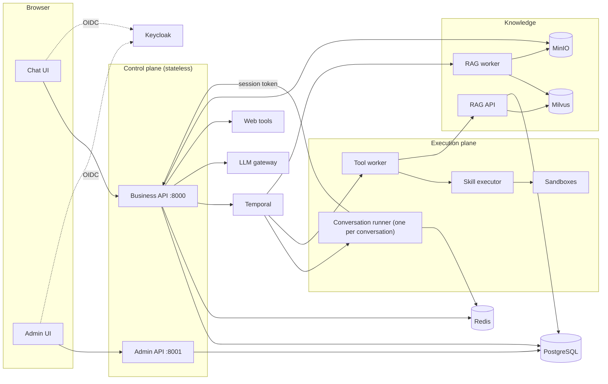
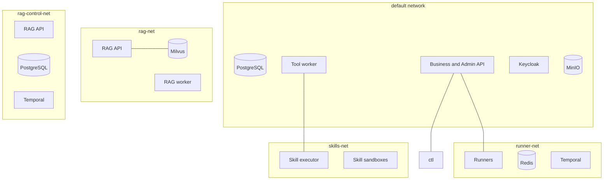
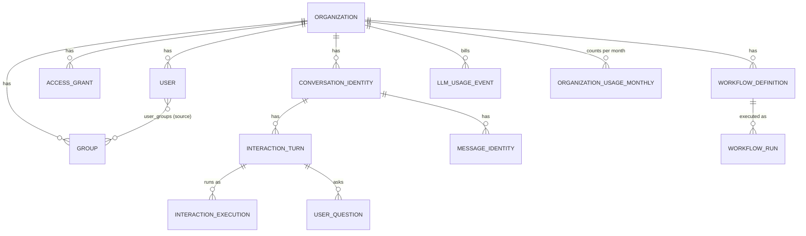
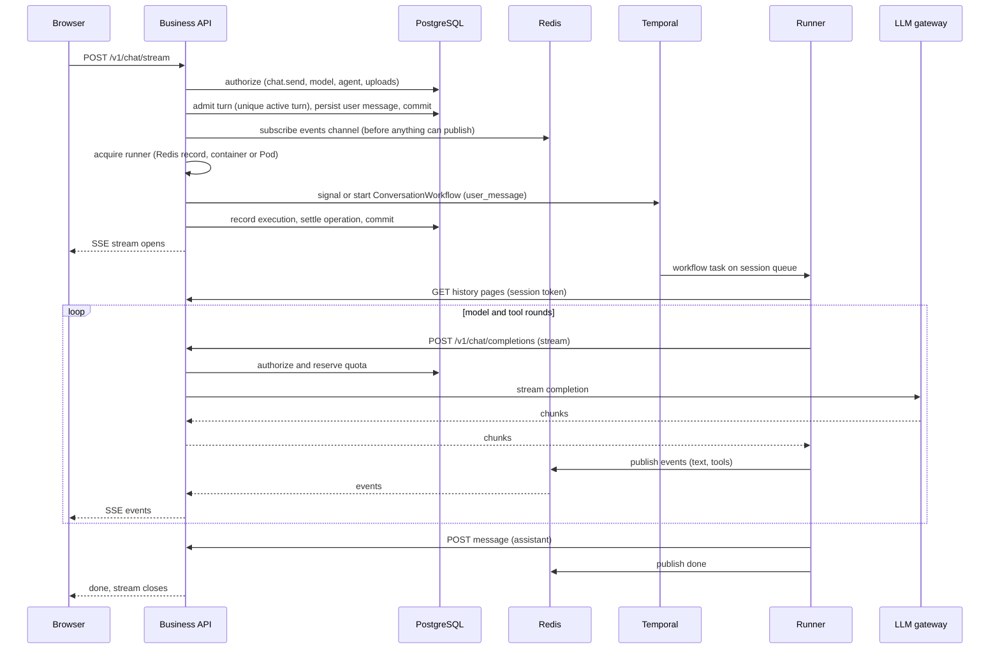
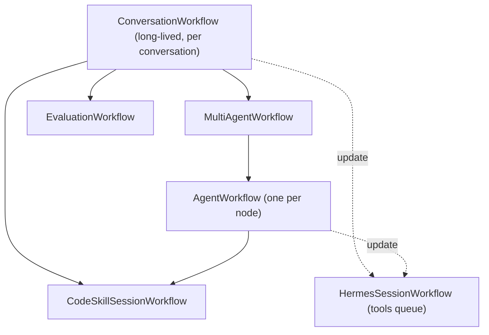
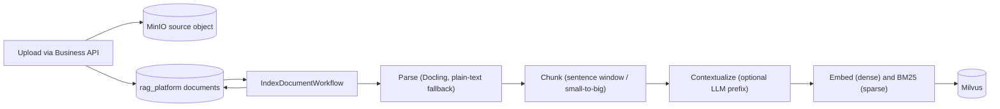

# AurumAI technical architecture

This document is for architects and reviewers who need to understand how AurumAI is
built, why it is built that way, where its boundaries are and how it behaves under load
and failure. It complements the shorter [architecture overview](ARCHITECTURE.md) (which
lists the rules contributors must preserve), the [Hermes Agent design](HERMES_AGENT.md)
and the [security model](reference/security.md). It describes the code as it is on
`main`; where behaviour is configurable the setting is named, and the
[configuration reference](CONFIGURATION.md) has the details.

Contents:

1. [Goals and design principles](#1-goals-and-design-principles)
2. [System overview](#2-system-overview)
3. [Deployment topologies and trust zones](#3-deployment-topologies-and-trust-zones)
4. [Backend architecture](#4-backend-architecture)
5. [Identity and authorization](#5-identity-and-authorization)
6. [Data architecture](#6-data-architecture)
7. [The chat turn, end to end](#7-the-chat-turn-end-to-end)
8. [Durable execution with Temporal](#8-durable-execution-with-temporal)
9. [Conversation runners](#9-conversation-runners)
10. [Multi-agent workflows](#10-multi-agent-workflows)
11. [Tools, skills and code execution](#11-tools-skills-and-code-execution)
12. [Durable questions](#12-durable-questions)
13. [Knowledge: the RAG pipeline](#13-knowledge-the-rag-pipeline)
14. [Web tools and network egress](#14-web-tools-and-network-egress)
15. [Hermes Agent](#15-hermes-agent)
16. [Model access, quota and usage](#16-model-access-quota-and-usage)
17. [Data lifecycle: partitions, archive, restore](#17-data-lifecycle-partitions-archive-restore)
18. [Frontends](#18-frontends)
19. [Observability](#19-observability)
20. [Scalability and capacity](#20-scalability-and-capacity)
21. [Failure modes and recovery](#21-failure-modes-and-recovery)
22. [Compatibility and evolution rules](#22-compatibility-and-evolution-rules)
23. [Known limits and non-goals](#23-known-limits-and-non-goals)
24. [Source map](#24-source-map)

## 1. Goals and design principles

AurumAI is a self-hosted, multi-tenant platform for chat with models and agents,
knowledge bases, skills and tools, multi-agent workflows and an optional sandboxed
coding agent. Organizations are the tenants. The design follows from five commitments,
and most of the structure below is a consequence of them.

| Principle | What it means in the architecture |
|---|---|
| **Tenant isolation is enforced by the database, not only by code** | Every tenant table has PostgreSQL `FORCE ROW LEVEL SECURITY`; the tenant is set per transaction (`SET LOCAL`), so a pooled connection cannot carry one organization's context into another's request. Object keys, vector filters and Redis channels carry the organization as well. |
| **Authorization is live and default-deny** | Tokens carry identity only. Capabilities and resource grants are read on each request and between workflow steps, so a revoked grant stops a turn that is already running. There is no permission snapshot in any token, workflow input or template. |
| **Long work is durable, short work is stateless** | Anything that outlives a request (a conversation, a multi-agent run, indexing, a Hermes session) is a Temporal workflow. The API processes are stateless and can be restarted or scaled freely. |
| **Untrusted execution has one way out** | Tenant code, model-chosen shell commands and web fetching run in separate, resource-bounded environments with no general network. Each has exactly one enforced egress component. |
| **Fail closed and keep evidence** | Ambiguity (an unknown child workflow, a missing receipt, an unreadable archive part) blocks destructive steps instead of guessing; terminal states are written before streams are closed. |

The system is deliberately split into small trust zones with explicit contracts between
them (section 3). The price is more moving parts than a monolith; the benefit is that a
compromise or a bug in one zone (a code skill, a model-driven terminal, a parser) cannot
reach tenant data in another.

## 2. System overview



### 2.1 Component inventory

| Component | Technology | State | Scales by | Notes |
|---|---|---|---|---|
| `business-backend` (Business API) | FastAPI, SQLAlchemy 2 async, Gunicorn + Uvicorn workers | none (stateless) | replicas and workers | Entry point `main_business.py`, port 8000: chat, conversations, settings, knowledge, workflows, internal service routes. |
| `business-backend` (Admin API) | same image, `main_admin.py` | none | replicas | Port 8001: skills, grants, groups, models, agents, workflow authoring, analytics. Separate Keycloak audience. |
| `business-ui`, `admin-ui` | Next.js 16, React 19, TanStack Query, `keycloak-js` | none | replicas | Two independent browser applications; runtime configuration is injected per request. |
| `conversation-runner` | Python, Temporal worker | one Temporal task queue per conversation | one container or Pod per active conversation | Executes `ConversationWorkflow` and its child workflows; has no database access. |
| `tool-worker` | Python, Temporal worker on the `tools` queue | none | replicas | Executes skills (HTTP, MCP, code) and the Hermes session workflows. |
| `skill-executor` | Python, Docker or Kubernetes API client | in-memory sessions plus durable Hermes records | one logical instance | Creates and controls sandboxes; the only component allowed to do so. |
| `rag-api`, `rag-worker` | FastAPI; Temporal worker on `rag-ingest` | PostgreSQL `rag_platform`, Milvus | replicas | Own database and role, separate from the application database. |
| `web-tools` | FastAPI | none | replicas | Authenticated search/read adapter with its own URL and address policy. |
| `hermes-egress`, `hermes-preview` | nftables guard + proxy; preview proxy | none | per runtime | Only way out of a Hermes sandbox; only way a browser reaches a preview. |
| `identity-worker`, `data-worker` | Backend image, `maintenance_worker.py` | PostgreSQL inbox/jobs | one each | Optional: durable identity synchronization and archive lifecycle. |
| PostgreSQL | pg_partman 5.5, pgvector extension available | all application state | vertically; pooler | One database per concern: `aurum_ai`, `rag_platform`, `langfuse`, `temporal`. |
| Redis | Redis 7 | ephemeral: runner records, event bus, rate counters | n/a | Nothing in Redis is a system of record. |
| Temporal | server 1.32 | workflow histories | n/a | The durable-execution substrate. |
| Keycloak | 26 | identities | n/a | OIDC provider; owns membership and the `org_admin` role. |
| MinIO / S3 | S3 API | files, uploads, snapshots, archives | n/a | Business bucket, plus an archive bucket with narrower rights. |
| Milvus (+ etcd) | 2.5 | vectors | n/a | Dense and sparse vectors per knowledge base chunk. |
| LLM gateway | any OpenAI-compatible endpoint; Bifrost overlay for local use | none | n/a | Holds provider credentials; the platform never exposes them to runners. |
| Langfuse (+ ClickHouse) | 3.x | traces and scores | n/a | Optional. |

Two properties are worth stating up front. First, **the runner has no database
connection**: it talks to the backend over HTTP with a short-lived identity-only token,
so every read and write a runner makes goes through the same authorization code as a
browser. Second, **no component other than the Business API writes the conversation
tables**; workers report results (persist a message, register an execution) through
internal API routes.

## 3. Deployment topologies and trust zones

Two supported topologies share the same images and configuration surface.

**Docker Compose** (`docker-compose.yml` plus overlays) is the development and
single-host topology. Profiles select optional parts (`rag`, `skills-exec`, `mcp`,
`maintenance`, `archive`); overlays add the proxy and TLS, the Hermes runtime, the real LLM
gateway and the end-to-end test fixtures. The backend is given Docker-socket authority to
create runner containers, which is root-equivalent on the host; the security model says
to use Compose only on a trusted host.

**Kubernetes** (the Helm chart in `charts/aurum-ai`) replaces the Docker socket with
namespace-scoped RBAC. The chart separates concerns into namespaces: the release
namespace (APIs, UIs, workers, executors), a runners namespace (one Pod per
conversation), a sandboxes namespace (code-skill sandboxes), and optional Hermes and web
namespaces, each with default-deny `NetworkPolicy` objects. The APIs and UIs have
`HorizontalPodAutoscaler` templates; the backend defaults to three replicas.

### 3.1 Network zones (Compose)



The point of the zoning is what each zone cannot reach. Runners reach Temporal, Redis and
the backend (and Langfuse when tracing is on); they cannot reach PostgreSQL, MinIO or Milvus. Sandboxes
reach nothing. Milvus has no route from the application networks except through the RAG
API. The exact map and its negative tests are in
[network enforcement](operations/network-enforcement.md).

### 3.2 Trust levels

| Zone | Trusted with | Not trusted with |
|---|---|---|
| Control plane (APIs, UIs, workers' orchestration code) | Authorization decisions, secrets, database roles | Tenant-supplied code or markup |
| Runners | One conversation's history and model calls, via the backend | Any data store, provider credentials, other conversations |
| Tool worker | Calling skills on behalf of a turn | Running tenant code itself |
| Skill sandboxes | Executing a code skill | Network, secrets, anything outside the session |
| Hermes sandbox | A workspace and a terminal | Everything except two platform endpoints and the egress mode the organization chose |
| Web tools | Fetching public pages under policy | Private ranges, credentials, arbitrary redirects |

## 4. Backend architecture

### 4.1 Process model

The Business and Admin APIs are two FastAPI applications built by one factory
(`app_factory.create_app`): the same CORS, error-handling, rate-limit, metrics and audit
middleware, different router lists and lifespans. Each runs under Gunicorn with Uvicorn
workers (`APP_WORKERS`, default `2 × CPU + 1`). Every worker owns its own database
pool, so replicas × workers × pool size is the connection budget (section 20.1).

The Business API lifespan starts the background loops that coordinate with the runtime:
the runner reaper and (on Docker) pool maintainer, the interaction-outbox dispatcher, the
interaction-maintenance loop, the retention reaper for workflow runs, the web-result
scrubber and the Hermes idle-session closer. These are in-process asyncio tasks designed to
run in every replica: they claim work through leased database functions (for example
`claim_interaction_outbox`), row locks or Redis records rather than assuming a single instance.

### 4.2 Layering

```
routers/        HTTP surface, request validation, dependency wiring
  ↓
services/       use cases and policies (authorization, quota, interaction, runners…)
  ↓
repositories/   persistence queries, one aggregate each
  ↓
models/         SQLAlchemy mappings; schemas/ holds the Pydantic wire types
```

Cross-cutting pieces live in `core/` (config, auth, database, Temporal client, event bus,
telemetry) and `middleware/`. Routers never talk to Temporal, Redis or the executors
directly when a service exists for it; services never import routers.

### 4.3 Request pipeline

Middleware order is deliberate. From outermost to innermost: audit, metrics, rate limit,
then the router. Audit and metrics wrap the rate limiter so they also observe rejected
(`429`) mutations.

* **Rate limiting** is a Redis counter per `(organization, user, bucket, minute)`. The
  identity is read from whichever token the caller presented (Keycloak, runner session or
  Hermes); unauthenticated callers fall back to the client address. Chat streams have their
  own, smaller budget (30 per minute against 300) so browsing cannot exhaust the allowance
  to start a turn.
* **Audit** writes one `audit_logs` row per mutating request (`POST`, `PUT`, `PATCH`,
  `DELETE`), keyed by route template rather than object URL so resource IDs do not leak
  into the journal. The write completes before the response is returned, on a dedicated
  single-connection pool that request-scoped dependencies cannot starve; a storage failure
  is logged and does not change the outcome of a mutation that may already have committed.
  Service-to-service decision routes that have their own journals (Hermes egress and
  preview checks) are skipped.
* **Metrics** records a request counter and duration histogram per route template.

### 4.4 Three API audiences

| Audience | Authenticates with | Database dependency | Typical routes |
|---|---|---|---|
| Browser, business plane | Keycloak JWT, audience `business-ui` | `get_org_db_session` | chat, conversations, settings, knowledge |
| Browser, admin plane | Keycloak JWT, audience `admin-ui` | `get_org_db_session` | `/v1/admin/*`, skills, grants |
| Services (runner, tool worker) | Runner session token (`type: session`) | `get_service_db_session` | `/v1/chat/completions`, `/v1/internal/*`, message persistence |
| Hermes sandbox | Hermes session token (own audience) | `hermes_db_session` | the model proxy and the MCP bridge only |

Routers consumed by runners must use `get_current_user_or_session` and
`get_service_db_session`; the browser-only dependencies reject session tokens. This is
the single most common integration mistake and is called out as a rule in the overview.

## 5. Identity and authorization

### 5.1 Identity

Keycloak authenticates people through OpenID Connect; the platform stores no passwords.
The backend validates issuer, signature (JWKS) and audience. Two audiences keep the planes
apart: a token minted for the chat application does not open the Admin API. Group
membership comes from the signed `groups` claim plus people an administrator adds by hand
(`user_groups.source` distinguishes them; the sign-in sync never touches manual rows).

On each authenticated request `_set_org_and_sync` places the organization on the session
(`session.info["org_id"]`) and reconciles the user and groups from the claims. The sync is
designed to be a no-op for a signed-in person: it refreshes `last_login_at` and a group's
`last_synced_at` at most every 15 minutes and does not commit when nothing changed, which
matters because it runs on every request and every member of a group shares the group row.

Optional **identity synchronization** (`IDENTITY_SYNC_ENABLED`) moves this reconciliation
to a durable inbox processed by `identity-worker`, with generation fencing. A signed
`platform_groups_complete` claim distinguishes "explicitly no groups" from "claim missing".
If the worker is down, changed identities are admitted for a bounded time as
`identity_sync_pending` rather than accepting stale privilege indefinitely. Tokens are not
copied into the inbox or into Temporal history.

### 5.2 Service tokens

| Token | Issued by | Claims | Lifetime | Accepted by |
|---|---|---|---|---|
| Runner session token | `SessionManager`, refreshed by the runner | `sub`, `org_id`, `conversation_id`, `generation`, `type=session` | 30 minutes; the runtime refreshes after 20 | internal and service routes |
| Hermes session token | Hermes session service | adds `sid`, `tv` (token version), audience `hermes-session` | the session's expiry | only the model proxy and the MCP bridge |

Both are HS256 JWTs signed with the stack secret and contain identity only. What a token
may do **right now** is decided per request: the Hermes token additionally has to match an
open session row on the same token version and a turn bound to it; the runner token's
`generation` is checked against the conversation fence (below). Leaving permissions out
of tokens is what makes revocation immediate.

### 5.3 Capabilities and grants

Two orthogonal mechanisms, both evaluated live from the database:

* **Capabilities** answer "may this person do this kind of thing": `chat.send`,
  `web.access`, `images.generate`, `agents.hermes`, `workspace.skills.create`,
  `workspace.knowledge.create`, `workspace.agents.create`, `sharing.manage`,
  `admin.users.read`, `admin.users.write`. They are granted to an organization and to
  groups (`organization_capabilities`, `group_capabilities`); a person's effective set is the
  union. Organization administrators (`org_admin` in Keycloak) hold all of them.
* **Resource grants** (`access_grants`) answer "may this person use this specific
  thing": a resource (`model`, `skill`, `knowledge_base`, `agent_definition`, `workflow`),
  a principal (`organization`, `group`, `user`) and a permission (`read`, `write`).

Access is default-deny. A new organization is provisioned on first verified login with
`chat.send` and grants for global skills and models only; everything else is switched on by
an administrator. `AuthorizationService` is the single evaluation point:
`has_capability`, `can_access`, `accessible_resource_ids` (the last pushes the visibility
filter into list queries). An administrator's bypass is limited to their own organization
and never bypasses row-level security or runtime-owner rules.

### 5.4 Conversation generation fence

A conversation has a lifecycle generation. Runner tokens carry the generation they were
issued under; `fence_session_conversation` locks the live conversation, checks that its
registry row is active and that the generation matches, and re-applies that fence at the
start of every later transaction in the request (`after_begin`). When a conversation is
archived, restored or deleted, the generation advances and callbacks from an old runner
fail with `ConversationFrozen`. This is the mechanism that makes archive and restore safe
against in-flight work.

## 6. Data architecture

### 6.1 Stores and what each is authoritative for

| Store | Authoritative for | Loss impact |
|---|---|---|
| PostgreSQL `aurum_ai` | Users, groups, grants, conversations, messages, turns, workflow definitions and runs, skills, agents, knowledge-base metadata, quota ledger, audit, Hermes session records | Platform down; restore from backup (see [backup and recovery](operations/backup-recovery.md)) |
| PostgreSQL `rag_platform` | RAG document metadata, ingestion state, knowledge-base lifecycle | Documents unsearchable until restored or re-indexed |
| Temporal | In-flight workflow state | In-flight turns lost; persisted history is unaffected |
| Redis | Runner records and pool, event bus, rate counters | Runners are re-created, live streams reconnect from snapshots; no data loss |
| Milvus | Chunk vectors (derived from MinIO and PostgreSQL) | Re-indexable |
| MinIO | Uploaded source files, images, Hermes snapshots, archives | Files lost; backup separately |
| Langfuse / ClickHouse | Traces and scores | Observability only |

The rule of thumb: **PostgreSQL holds the truth, everything else is a cache, a queue or a
derivation.** Redis in particular never holds anything that cannot be rebuilt: it has no
volume in the default stack, and a reboot is handled by the startup sweeps (section 9.3).

### 6.2 PostgreSQL roles and row-level security

Four database roles separate privileges:

* a **migration/owner** role used by Alembic only;
* `aurum_ai_app`, the runtime role of the APIs: `SELECT/INSERT/UPDATE/DELETE` on
  application tables, no schema ownership, no `BYPASSRLS`;
* `aurum_ai_lifecycle` (`NOLOGIN`), whose privileges are granted to a separate login role
  for the data worker, so archive and purge rights never sit on the API role;
* `rag_app`/`rag_lifecycle` for the RAG database.

Every tenant table has `ENABLE` and `FORCE ROW LEVEL SECURITY` with a policy keyed on the
`app.current_org_id` setting. The setting is applied by a SQLAlchemy `after_begin` hook on
the application's session class, using `set_config(..., true)` (transaction-local). This
matters because an async session can be handed a different physical connection after each
commit; re-issuing the context at every transaction start, rather than once per request,
removes the whole class of "connection kept the previous tenant" bugs and cannot leak
into the next request that reuses the connection. The same hook re-applies the conversation
generation fence for service sessions.

Security-definer functions (partition maintenance, archive discovery, the web-result
scrubber, identity dispatch) run as isolated `NOLOGIN` owners, so privileged operations are
a short, reviewable list of functions rather than broader grants.

### 6.3 Partitioned payload and identity registries

`conversations`, `messages` and `audit_logs` are range-partitioned by `created_at` in
monthly UTC partitions managed with `pg_partman` (three months pre-made; automatic
maintenance runs through the vetted `platform_maintain_partitions()` routine; retention is
left to the archive worker). Partitioning serves two goals: bounded index and vacuum cost
for tables that only grow, and cheap removal of old payload.

Because a partitioned table cannot be referenced by a foreign key from rows that must
survive payload movement, **permanent UUID identity registries**
(`conversation_identities`, `message_identities`) hold the identity of each conversation
and message independently of where the payload lives. Foreign keys, unique and idempotency
keys and RLS reference the registries, so they stay valid when a payload partition is
archived and later restored.

Two rules follow for anyone writing queries against these tables:

* A `messages` query must bound `created_at`; the history read uses the conversation's
  creation time (minus a day of slack) as the lower bound and joins on the whole primary key
  `(id, created_at)`. Without the bound the planner probes every monthly partition and
  planning time grows with every month of history.
* A foreign key with `ON DELETE CASCADE` or `RESTRICT` needs an index that *starts with the
  referencing columns*, or deleting the parent scans the child. The `20261111` migration
  added the missing ones and removed `org_id`-only indexes that another index already
  covered.

### 6.4 Key aggregates



The interaction tables carry the turn-level state machine:

* `interaction_turns` has a partial unique index on `(org_id, conversation_id)
  WHERE status = 'active'`. That index **is** the "one running turn per conversation" rule;
  a second concurrent send fails with a conflict that the API maps to `409`, with no
  application-level lock.
* `interaction_executions` records the exact Temporal address (workflow id, run id, task
  queue, parent link) a turn executes under, so cancellation, question delivery and cleanup
  target the right run and never a successor.
* `user_questions` and `interaction_outbox` implement durable questions (section 12).
* `tool_operations` gives each web or image operation a reservation, attempt count and
  deadline.

### 6.5 Migrations

Alembic migrations are linear and reversible, and run as a Helm pre-install/upgrade Job or
through the backend entrypoint on Compose. Notable migration disciplines:

* Index creation on partitioned tables takes a write lock while it builds; the changelog
  flags such migrations so a large installation upgrades in a quiet period.
* The runtime role is created by the first migration with a password taken from the
  environment; the migration refuses placeholder secrets outside debug mode.
* Existing-table conversion to partitions requires a backup and a writer-free window.

### 6.6 Redis usage

| Key space | Purpose | Loss handling |
|---|---|---|
| `{org}:session:{conversation}:events` (pub/sub) | Live event stream from the runner to the API's SSE relay | A lost message is recovered from durable turn/question snapshots on reconnect |
| `session_containers` hash, field `{org}:{conversation}` | Which runner serves which conversation | Rebuilt by `cleanup_stale` and `sweep_orphans` at startup |
| `runner_pool` | Warm, unbound runner containers (Docker only) | Topped up by the pool maintainer |
| `rate_limit:{org}:{user}:{bucket}:{minute}` | Rate counters, 60 s TTL | Self-healing |

## 7. The chat turn, end to end

This is the central path; most of the platform's guarantees are visible in it.



### 7.1 Admission (synchronous, in the request)

1. **Authenticate and authorize.** `chat.send` capability, then live checks on the model,
   the selected agent or workflow (resource grants), attachments and uploads. Hermes turns
   check `agents.hermes` and the agent's own model.
2. **Admit the turn.** An `interaction_turns` row is inserted `active`. The partial unique
   index makes a concurrent send fail cleanly. Uploaded images and files are claimed for the
   turn (single-use, owner-checked) and the user message is persisted with its `turn_id`;
   the transaction commits before any slow I/O.
3. **Subscribe before signalling.** The API subscribes to the conversation's Redis channel
   *before* the runner can publish, because Redis pub/sub does not buffer for late joiners;
   the first events (message start, thinking deltas) are emitted within milliseconds of the
   signal.
4. **Acquire a runner and signal.** `SessionManager.get_or_create` returns the owned runner
   for the conversation (section 9); then the API signals `ConversationWorkflow`
   (`user_message`), starting it if needed with an exactly-recorded run id. Lifecycle
   operations (`begin_operation`/`settle_operation`) record the signal so archive cannot
   race it.
5. If the runtime or Temporal is unavailable the turn is marked failed (`503`), the
   subscription is released and the user sees a retryable error instead of a hung stream.

The request then returns a `StreamingResponse` that relays events from the channel. The
event generator stops on `done` (or on `message-score` when a background evaluation was
pending) and has an overall timeout (`EVENT_SUBSCRIBE_TIMEOUT`); a lost wake-up is
recovered by the UI reading the durable turn snapshot, not by replaying Redis.

### 7.2 Execution (asynchronous, in the runner)

`ConversationWorkflow` is a long-lived workflow per conversation. It loads the complete
persisted history (paginated, with cursors validated so a missing or repeated cursor cannot
silently publish a partial conversation), then waits for messages. For each turn it runs
the tool loop: build the system prompt from the user's *currently accessible* skills, call
the model (`llm_call` activity, streaming), parse `<tool_call>` blocks, execute tools as
activities or child workflows, feed results back, and stop when the model answers without a
tool call. It persists the assistant message, publishes the terminal events and, if
configured, starts a background evaluator.

Two behaviours are intentional:

* **A failed turn still closes the stream.** `_fail_turn` persists the terminal state first,
  then publishes `message-end` with the reason and `done`. An escaping exception would kill
  the long-lived workflow and every later message with it, so turn failures are contained
  inside the loop; Temporal cancellation is not (it is a `BaseException`).
* **The model is always called with `stream: true`.** The proxy endpoint has no buffered
  path; a non-streaming request upstream would return an empty body without an error.

### 7.3 The model call path

The runner never sees a provider credential. It calls the backend's
`/v1/chat/completions` (OpenAI-compatible, always streaming) with its session token. The
backend authorizes the capability and model again with live data, resolves vision images,
**commits to release its database connection before any provider I/O**, reserves quota
(section 16), and proxies the gateway stream while accounting usage. Because the proxy runs
inside the request that the runner awaits, quota, authorization and audit apply uniformly to
every model call a platform feature makes, whether it came from a chat turn, a workflow
node, a classifier or an evaluator.

## 8. Durable execution with Temporal

### 8.1 Namespaces, queues and workers

| Task queue | Worker | Workflows | Activities |
|---|---|---|---|
| `session-{conversation_id}` | the conversation's runner | `ConversationWorkflow`, `MultiAgentWorkflow`, `AgentWorkflow`, `CodeSkillSessionWorkflow`, `EvaluationWorkflow` | model call, history load, message persistence, event publish, scoring, question operations, web and image tool calls, workflow-run transitions, Hermes hand-off |
| `tools` | tool worker | `HermesSessionWorkflow`, `HermesSkillCallWorkflow`, `HermesFileAttachWorkflow`, `HermesConversationPurgeWorkflow` | `execute_skill`, code-skill session open/exec/close, the Hermes sandbox activities |
| `rag-ingest` | RAG worker | `IndexDocumentWorkflow` | register execution, `index_document`, `mark_document_failed` |

One task queue per conversation is the isolation device: the runner container that owns a
conversation is the only worker polling its queue, so its workflow code runs only inside
that conversation's container (and its resource limits), and tenant boundaries on the
execution plane follow container boundaries. Workflow ids are deterministic
(`conversation-{conversation_id}`).

### 8.2 Workflow tree



The backend contains `ConversationWorkflow` only as a **typed client stub**, so it can
signal and start the real workflow that lives in `conversation-runner`. Signal names and
payloads must be kept in sync between the two; the signals are `user_message`,
`cancel_generation`, `cancel_turn`, `cancel_workflow_run`, `question_available`,
`hermes_turn_result`, `hermes_question` and `hermes_question_settled`. Agent nodes do not
create runners: the whole tree executes inside the one conversation runner.

### 8.3 Determinism and replay compatibility

Workflow code is replayed from history after any worker restart, so it must be
deterministic and **old histories must keep replaying after upgrades**. The repository
enforces this with named `workflow.patched(...)` markers, one per behaviour change
(`user-questions-v1`, `web-tools-v1`, `image-tools-v1`, `chat-agent-v1`,
`conversation-lifecycle-v1`, `failed-turn-terminal-v1`, `loop-iteration-context-v1`,
`evaluator-explicit-model-v1`, `hermes-v1` and the Hermes family, `rag-lifecycle-v1`,
`conversation-temperature-v1`, `hitl-progress-heartbeats-v1`) and replay tests built from
recorded histories. Rules that follow:

* never remove or rename a marker that an old history may contain;
* never read mutable settings inside workflow code; the backend sends flags such as
  `user_questions_enabled` with each turn, and mutable configuration is read inside
  activities, which are outside the replay sandbox;
* a new behaviour is introduced behind a new marker, with a replay test for histories from
  before and after.

### 8.4 Retries and timeouts

Activity retries are bounded (`maximum_attempts=3` for runner activities) because the
default unlimited retry would turn a persistent 4xx into a conversation that never
recovers. Genuine client errors are raised as non-retryable `ApplicationError` at the
activity so they fail on the first attempt. Activity timeouts are short for control calls
(30 s) and explicit for long ones (10 minutes with a heartbeat for indexing; the turn
deadline for Hermes).

## 9. Conversation runners

### 9.1 Runtime abstraction

`SessionManager` binds a conversation to a runner through an abstract runtime with two
implementations: Docker (`aiodocker`, containers on the runner network, memory and CPU
quotas) and Kubernetes (Pods in the runners namespace, labelled with release and
conversation, with CPU/memory requests and limits). Helm selects Kubernetes and requires a
pool size of zero because there is no warm pool on Kubernetes.

### 9.2 Binding, pooling and tokens

* **Ownership record.** A Redis hash entry `{org}:{conversation}` records the resource id,
  its UID and creation data. A runner is reused only if the record matches the live runtime
  object (id, UID, labels); a mismatch is treated as a different resource and never adopted
  or deleted blindly.
* **Warm pool (Docker).** Unbound containers wait in `runner_pool`; claiming one calls its
  `/bind` endpoint with the conversation identity and token, which removes the cold-start
  cost (container creation plus imports, a few seconds). The runner connects to Temporal
  while waiting for the bind.
* **Token refresh.** Runner tokens last 30 minutes and are refreshed after 20; long waits
  (confirmation nodes, questions) refresh the runner's activity so reapers do not race them.

### 9.3 Reaping and recovery

* **Idle reaping.** Runners idle for `RUNNER_IDLE_REAP_SECONDS` (30 minutes) are removed,
  except those a durable wait protects (a pending question or confirmation).
* **Startup sweeps.** `cleanup_stale` removes records whose runtime is gone;
  `sweep_orphans` removes labelled runtime objects whose Redis record is gone, which is
  every runner after a host reboot because Redis has no volume.
* **Kubernetes safety.** Deletion verifies release and conversation labels and the Pod UID
  first, under a Redis lease sized to the full reconciliation budget, so a slow reconcile
  cannot be overtaken and an unrelated Pod is never deleted.
* The workflow itself also ends after `idle_ttl_seconds` (default 600) without messages; the
  next message starts a fresh run and reloads history from PostgreSQL. **A runner crash
  loses no history**, because PostgreSQL is the only history store.

## 10. Multi-agent workflows

A workflow definition is a versioned graph of agent nodes plus a supervisor. Definitions
and templates are administrative resources with their own grants.

* **Admission** creates an immutable **execution snapshot** of the definition and its model
  dependencies (`workflow_runs`). The snapshot fixes *configuration*, not *access*: the
  preparation step, every node and the synthesis step re-check live grants through
  `authorize_workflow_step`, so a revoked model or skill stops the next node.
* **Scheduler.** Fixed graphs of up to 20 nodes with concurrency up to 4; ready nodes run
  in lexical order; edges can be conditional (`on_success`, `on_failure`); joins are AND;
  a failure with no handler cascades a skip. Only a successful supervisor synthesis is
  exposed as the final answer; an unhandled failure never produces a false success.
* **Loops.** Loop-back edges (`is_loop_back`, `max_iterations` 2–20) keep the structural
  graph acyclic. A loop body is the intersection of the target's descendants and the tail's
  ancestors; nested or overlapping bodies, confirmation nodes inside a body and fan-out from
  a non-tail node are rejected at validation. On a loop-back the body is reset and iteration
  N+1 receives `previous_iteration` with every terminal result of iteration N (64 KiB per
  node, 512 KiB total); older passes are never accumulated.
* **Human confirmation** is a durable owner-controlled signal with a bounded wait (1800 s in
  production), renewing the runner's activity so the reaper does not take the container.
  Rejection, timeout and exact-run cancellation end only that run.
* **Routing.** An explicit picker selection wins; opt-in classification routes an ordinary
  turn only among accessible, auto-routable definitions and falls back safely on any
  failure.
* **Observability.** Run and node diagnostics are organization-scoped; progress events carry
  an allowlist of metadata only, never node briefs, internal outputs or raw tool payloads.
* **Billing.** Every node's model call goes through the same quota ledger with the run, phase
  and node key recorded.

## 11. Tools, skills and code execution

Skills are the unit of extension. There are three kinds, all granted like any resource:

| Kind | Execution | Isolation |
|---|---|---|
| Built-in tool | `execute_skill` activity on the tool worker (for example the knowledge-base hybrid search, which calls the RAG API with the caller's session token) | The tool worker's own network policy; no tenant code |
| MCP | MCP client in the tool worker; **SSE** transport for tenant skills, stdio only for operator-global skills (`org_id` null) | A saved token never follows a changed endpoint; the unrestricted fetch server in the repository is a development fixture |
| Code | Source ZIP bundle with `SKILL.md`; runs in an ephemeral sandbox opened by `skill-executor` | Separate namespace and RBAC, resource limits, no network by default, bounded rounds and per-command timeouts |

**The tool-call protocol** is plain text: the model emits
`<tool_call>{"skill_id": "...", "args": {...}}</tool_call>`, parsed by one shared parser
in the runner. This keeps the platform provider-agnostic (it does not depend on a provider's
native function-calling format) and is why the system prompt forbids native tool markup.
The backend serves camelCase JSON; the tool worker normalizes to snake_case.

**Code skills** run as `CodeSkillSessionWorkflow`: open a sandbox, let the model issue
several commands (default at most 8 rounds, 60 s per command), return each result to the next
round, close. The skill executor enforces its own session TTL independently of the workflow,
so a stuck workflow cannot leak a sandbox. Tenant code never runs in the tool worker's
environment; and because `pods/exec` cannot be constrained by labels, sandboxes live in a
dedicated namespace with their own RBAC.

## 12. Durable questions

A model can ask the person a question mid-turn (`ask_user`). It is server-owned and
default-off; the backend sends the enabling flag with every turn so workflow code never
reads a mutable flag.

State lives in PostgreSQL: a `user_questions` row per question, an operation reservation for
idempotency and an `interaction_outbox` row that the **outbox dispatcher** (a background
loop that leases batches through the `claim_interaction_outbox` function) turns into a Temporal
signal to the exact execution. This yields
at-least-once delivery with an explicit consume identity, so retries cannot double-deliver.
Limits: one pending question per execution, four concurrent and ten created per turn, and a
real 3600-second deadline. Answer, revoke, cancel, late answer and next-turn lock release are
separate, individually tested paths. A lost SSE wake-up is recovered because the UI reads
the durable snapshot; the stream is a hint, not the record.

## 13. Knowledge: the RAG pipeline

This section is a summary; the full design (data model, ingestion protocol, fences and intents,
retrieval, archive) is in the [RAG architecture](RAG_ARCHITECTURE.md).

### 13.1 Ingestion



Uploads pass through the backend into MinIO with explicit file and knowledge-base metadata.
The RAG worker downloads and parses the source, splits it into small search chunks with larger
parent windows (the model sees the parent, retrieval matches the small chunk), optionally asks
a model for a short document-level context line per chunk (contextual retrieval), embeds the
chunks and writes dense and sparse vectors. Each Milvus record carries `org_id` and
`knowledge_base_id`; the embedding dimension is configuration (1536 by default) and is
validated on every chunk. Indexing is idempotent and **generation-fenced** so a retried or
cancelled run cannot leave chunks behind a deleted document, and a Milvus partial failure
fails the activity (retried up to three times) rather than marking the document indexed.

### 13.2 Query

`rag-api` is an internal trust boundary: the public backend validates the caller's live
knowledge-base grant and passes the canonical organization and knowledge-base ids; RAG then
applies both to every SQL and Milvus lookup. Search embeds the query, runs a **hybrid**
search (dense cosine and BM25 sparse in one Milvus call, fused with reciprocal-rank fusion,
`k = 60`), caps the fetch size, filters hits to documents that still exist and whose
knowledge base is `active` in PostgreSQL (closing the delete race), and returns the parent
windows. Result size is clamped server-side because skill arguments are model-formed.

### 13.3 Ownership

Chat attachments create a conversation-scoped knowledge base and a hidden search skill bound
to that exact conversation and the caller's session. Knowledge-base deletion, upload,
indexing and archive admission share fences so an unresolved external write cannot become an
orphan. A legacy ambiguous owner blocks an operation instead of being guessed.

## 14. Web tools and network egress

`web.search` and `web.read` are platform tools gated by the `web.access` capability and a
global switch, implemented by the separate `web-tools` service. Three layers make "the
agent can browse" safe:

1. **Policy before every connection.** A frozen list of forbidden address ranges (private,
   loopback, link-local, carrier-grade NAT, documentation, 6to4 and others, IPv4 and IPv6) plus
   the operator's `WEB_EGRESS_FORBIDDEN_CIDRS`; IDNA-normalized host handling; the resolved
   address is checked and pinned, and redirects are re-validated hop by hop.
2. **Bounded parsing.** Fetched content is parsed in a sandboxed worker with size and time
   limits; the reader returns sources the platform owns.
3. **Network enforcement underneath.** A kernel/CNI-level egress guard (nftables for Docker,
   `NetworkPolicy` for Kubernetes) repeats the deny ranges, so a bug in the adapter is not
   the only barrier. The deny ranges are kept in sync across the adapter, the Docker guard and
   Helm.

Operations are durable: each has a reservation, bounded attempts and shared deadlines;
authorization is re-checked before I/O and before persisting; non-retryable results stay
non-retryable across service boundaries; a late result after cancellation or revocation is
discarded. Sources are conversation- and execution-owned and are validated as they propagate
through workflow synthesis. Image generation and editing follow the same operation pattern
(`tool_operations`) through the image API client.

## 15. Hermes Agent

Hermes Agent is an opt-in system agent with a terminal, run inside a per-conversation
sandbox. [HERMES_AGENT.md](HERMES_AGENT.md) is the full design; the architectural summary:

* **Execution model.** One long-lived `HermesSessionWorkflow` per conversation on the `tools`
  queue; the runner hands each turn to it as a Temporal Update and awaits the result. The
  sandbox belongs to the conversation, lives across turns, is snapshotted to object storage
  when idle and restored on demand. A turn's `run_hermes_turn` activity is idempotent (keyed by
  turn) and heartbeats, so a lost worker reattaches to the same run rather than starting a
  second.
* **Durable ownership.** Sandboxes are recorded in `hermes_sessions` and labelled in the
  runtime; after a restart `skill-executor` re-adopts live sandboxes and reaps only those past
  their limits or without a row. Limits (turn deadline, idle TTL, absolute lifetime, snapshot
  retention, per-organization and global capacity) are operator settings.
* **Network path.** The sandbox has no route of its own. `hermes-egress` is the only exit:
  a reverse proxy to exactly two backend paths (the model proxy and the MCP bridge of platform
  tools) and a `CONNECT` forward proxy governed by an egress mode (`none`, `packages`,
  `public`) chosen by the organization within the operator's maximum. Every new connection is
  authorized against the backend live (session open, token version, active turn, current mode,
  `web.access` for `public`), so closing a session or revoking a capability stops new
  connections within seconds.
* **Credentials.** The runner's token never enters the sandbox; Hermes has its own token type
  with its own audience, accepted by two routes only. Provider keys never enter it either:
  the model call goes through the backend proxy like any other, with quota and audit.
* **Previews.** `hermes-preview` is the one component browsers reach at a preview origin; it
  streams into the sandbox through the executor and the sandbox gains no network for it.
* **Authority over history.** PostgreSQL stays authoritative: each run receives the complete
  persisted history; Hermes's own state database is a rebuildable cache.

## 16. Model access, quota and usage

### 16.1 Model access

A model is usable when it is in the organization's catalog, **granted** to the person
(`access_grants`, resource type `model`), and, for features that need it, capable (vision,
image generation). The organization's default model and temperature are configuration, not
grants. Agent definitions may pin their own model; access to that actual model is still
required. The gateway is addressed by a single configured URL and credential held by the
backend; model identifiers are forwarded unchanged.

### 16.2 The quota ledger

Each model request is a row in `llm_usage_events` with a status machine
`reserved → accepted → completed` (or the reservation is cancelled). A per-organization,
per-month counter row (`organization_usage_monthly`) holds requests and tokens used.

* **Reserve** inserts the event (the request id is a unique identity that arbitrates
  retries; a duplicate with the same attribution counts once, a conflicting attribution is
  rejected without disclosing another tenant's event) and then touches the counter last, with
  **one conditional `UPDATE`** that both checks the limits and counts the request. The limit
  is exact. Only when that statement matches nothing does the code fall back to locking the
  counter row and deciding under the lock.
* **Accept** flips the event when the provider's response headers arrive; from then on the
  reservation cannot be reclaimed, however long the generation takes.
* **Complete** records exact provider token usage; **cancel** returns an unaccepted
  reservation.
* **Stale reservations** (`reserved` longer than 15 minutes, for instance after a backend
  crash) are deleted and the counter decremented by the next preflight or reserve for that
  organization, in a separate transaction taken before the counter lock.
* Usage transactions keep PostgreSQL's configured commit durability; the usage counts are
  therefore as durable as the rest of the database.

Period accounting is by UTC month. Analytics over arbitrary periods are derived from events
and are not the same number as monthly quota consumption.

### 16.3 Why a counter row

A single hot row per organization serializes that organization's model-request admissions;
the lock order is always event row then counter row, and the counter is held for one
statement. That makes the limit exact and the design simple, at the cost of a per-tenant
admission ceiling (section 20.3). Tenants do not contend with each other: each has its own
row.

## 17. Data lifecycle: partitions, archive, restore

* **Retention.** Archiving is default-off. When enabled, a conversation becomes eligible after
  `APP_ARCHIVE_RETENTION_DAYS` (180) without activity (creation, update, message or restore),
  and is not eligible while an unexpired Hermes session is open. Discovery works in bounded
  batches ordered by retention reach so blocked candidates cannot starve new ones.
* **Archive.** Payload is written to private, verified Parquet objects in a separate archive
  bucket before the source is purged; images and agent files are copied as their own checksummed
  objects. Independent checks must pass before purge. Billing and usage registries and the UUID
  identity registries stay in PostgreSQL.
* **Restore** is an operator procedure that preserves UUIDs, grants, typed payload, file
  checksums and original dense vectors (no replay of workflows and no re-embedding), advances a
  restore generation so old callbacks are fenced, and makes the conversation visible only after
  the bytes are read back.
* **Observers** preserve exact terminal receipts of Temporal executions before the history's own
  retention expires. Missing established history, unknown children, incomplete provenance or an
  ambiguous external-operation reply **block** purge.
* **Roles.** The data worker uses its own login role in the lifecycle group and an archive
  bucket account that can read and create but not delete.

See [data archive](operations/data-archive.md) for the procedures.

## 18. Frontends

Two Next.js applications (App Router, React 19, TypeScript, Tailwind, TanStack Query) and
`keycloak-js` in the browser. They are separate deployables with separate Keycloak clients and
audiences. Design decisions with architectural weight:

* **Runtime configuration, not build-time.** The server reads `RUNTIME_*` values on each
  request and serializes them into `window.__RUNTIME_CONFIG__`, so one image serves any
  deployment origin without a rebuild.
* **Streaming model.** Chat consumes SSE; tool-call cards merge by call id (not by replacing the
  previous batch); the composer is blocked while a turn is active, matching the server's
  unique-active-turn rule. Durable question reconnects use bounded backoff and stop on permanent
  authorization denial.
* **History loading.** The UI loads all history pages before replacing its local view; a missing
  or repeated cursor must surface as an error, never as a silently shorter conversation.

## 19. Observability

| Signal | Mechanism |
|---|---|
| Metrics | Prometheus counters and histograms per route template (`/metrics`); skill-executor and RAG expose their own |
| Traces | OpenTelemetry (OTLP) across the APIs and workers, with HTTP and SQLAlchemy instrumentation |
| LLM traces and scores | Langfuse (optional): one trace per conversation, generations per model call, faithfulness scores from the background evaluator; full-content capture is a deliberate setting because prompts and documents can be sensitive |
| Audit | `audit_logs` (mutating requests), `authorization_audit_event`, Hermes egress decision journal, preview journal |
| Health | `/health` is liveness; `/ready` checks required dependencies |

Security-sensitive status streams (turn and question status) are metadata-only by
construction: the publisher projects them onto an allowlist so a future caller cannot put a
prompt or an answer on a browser-facing channel.

## 20. Scalability and capacity

### 20.1 Connection budget

The APIs are stateless; what bounds them is PostgreSQL connections. Every worker process
holds up to `APP_DB_POOL_SIZE + APP_DB_MAX_OVERFLOW` request connections (20 + 40 by default)
plus one dedicated audit connection, so:

```
replicas × workers × (pool + overflow + 1)  +  RAG  +  Temporal  +  Keycloak  +  Langfuse  ≤  max_connections
```

The Compose stack starts PostgreSQL with `max_connections=200`; production sizing is the
operator's. A connection pooler is the standard answer beyond a few replicas; transaction-mode
pooling suits the per-transaction tenant context but is untested here (prepared statements and
driver settings need checking first).

Two design points keep the budget honest: request-scoped sessions release their connection
before slow I/O (`commit` before the model call; the turn event stream ends its transaction
before streaming and reads each snapshot with a short-lived session), so an open chat does not
pin a pooled connection "idle in transaction"; and the audit pool is separate so audit writes do
not compete with request connections held until the response ends.

### 20.2 Scaling by component

| Component | Scale lever | Limiting resource |
|---|---|---|
| Business / Admin API | replicas, workers | database connections; CPU for SSE relay |
| Runners | one per *active* conversation; idle reaping | memory (default 512 MiB each), container/Pod creation rate; warm pool on Docker |
| Temporal | server sizing, history shards | workflow task latency; keep histories bounded |
| Tool worker | replicas | concurrent skill and sandbox activities |
| Skill executor | single logical instance today | sandbox creation rate; kept stateless for non-Hermes sessions by TTL reaping |
| RAG | API replicas; worker replicas | embedding service throughput, Milvus |
| PostgreSQL | vertical, pooler, partition pruning | connections, write IOPS on the audit and message partitions |

### 20.3 Measured and structural limits

* **Reading a conversation list** is index-only on `(org_id, user_id, activity)`:
  with 300 000 conversations it dropped from about 34 ms (scanning every partition) to about
  0.4 ms and no longer grows with table size.
* **History reads** prune partitions by `created_at`: planning cost went from about 8 ms at 46
  partitions (growing monthly) to about 0.2 ms.
* **The per-organization quota counter** is the structural ceiling of model-request admission
  for one tenant, because every request of an organization updates the same monthly counter
  row, twice (when it is reserved and when it completes). Measured with `pgbench` against the
  current schema and queries, 24 concurrent clients, each running a full request lifecycle
  (reserve, accept, complete; three short transactions), PostgreSQL 16 in a local
  container on a development laptop (WSL2):

  | Scenario | Full lifecycles per second | Average latency |
  |---|---|---|
  | One organization, durable commit (the shipped setting) | about 320 | 75 ms |
  | 24 organizations, durable commit | about 930 | 26 ms |
  | One organization, `synchronous_commit = off` (not used) | about 610 | 40 ms |

  So a single tenant is limited to a few hundred model requests per second on this hardware,
  independent tenants do not slow each other down, and relaxing commit durability would have
  roughly doubled the single-tenant ceiling at the cost of losing the last moments of usage
  counts after a database crash; the platform does not do that. This measures the database
  work only; the application adds its own overhead (a stale-reservation sweep and the
  provider round trip, which is far longer than any of this). Disk flush latency dominates
  the durable figures, so measure on your own storage before capacity planning.
* **Sessions per host (Docker).** Each runner reserves memory; size hosts by
  `concurrent active conversations × runner memory` plus Hermes sandboxes.
* **Sign-in cost** is one indexed lookup and, in the common case, no write.

## 21. Failure modes and recovery

| Failure | What happens | Recovery |
|---|---|---|
| API replica dies mid-stream | Browser SSE drops; the turn keeps running in the runner and persists its answer | UI reopens and reads the durable turn snapshot and history |
| Runner container dies | Workflow stalls until its queue has a worker again; no history loss | Next send re-creates the runner (new Pod/container), workflow replays; stale records are swept |
| Redis lost | Live events and runner records vanish | Records rebuilt by startup sweeps; streams reconnect from snapshots |
| Temporal unavailable | Admission returns `503` for new turns, the turn is marked failed, subscriptions released | Retry after recovery; histories are durable |
| LLM gateway error or slow | Quota reservation cancelled or reclaimed; the turn fails with the reason and still closes the stream | User retries; stale reservations expire after 15 minutes |
| PostgreSQL unavailable | APIs fail readiness; workers retry activities within bounds | Restore service; no partial writes visible (transactions) |
| Backend crash between reserve and accept | Reservation stays `reserved` | Reclaimed by the next preflight/reserve for that organization |
| Worker outage with identity sync on | Changed identities admitted as `identity_sync_pending` for a bounded time | Restart the identity worker; admission tightens after the bound |
| Milvus partial failure on indexing | Activity fails and retries up to 3 times, then the document is marked failed | Re-index; search never serves a document the database says is gone |
| Archive ambiguity (unknown child, missing receipt, unreadable part) | Purge is blocked | Operator resolves; evidence is retained |
| Acceptance cleanup cannot prove exact ownership | Cleanup refuses and keeps the recovery journal | Operator inspects; broad prefix deletes are not a fallback |

General recovery stance: retry bounded, then fail with a stored reason; never guess identity.

## 22. Compatibility and evolution rules

These are the rules an architect should enforce in review; each exists because the opposite
caused a real defect.

1. **Replay safety.** New workflow behaviour goes behind a new `workflow.patched` marker; old
   markers stay forever; replay tests for histories recorded before and after.
2. **Signal and activity contracts.** The backend's `ConversationWorkflow` stub and the
   runner's workflow must keep signal names and payloads identical.
3. **Identity-only tokens.** Never put permissions, grants or capability snapshots into any
   token, workflow input or template.
4. **Service routes** use the session-aware dependencies; browser-only dependencies must not
   replace them.
5. **Tenant scope in every new table**: an `org_id`, `FORCE ROW LEVEL SECURITY`, a policy on
   the transaction setting, and grants to the runtime role only. Foreign keys that cascade
   need a leading-column index; partitioned tables need bounded `created_at` access.
6. **Streaming stays streaming.** The model call is always a stream; do not substitute a
   buffered call or add unsupported response formats in the `llm_call` path.
7. **Runtime configuration is runtime.** Do not replace `RUNTIME_*` with build-time
   `NEXT_PUBLIC_*` URLs.
8. **Network changes are three-place changes.** Deny ranges and egress allowances are kept in
   sync between the adapter, the Docker guard and the Helm policies, and verified with positive
   controls (an unavailable IPv6 path is incomplete coverage, not a passed negative).
9. **Documentation and migrations.** Migrations are reversible and flag blocking index builds;
   source, comments and documentation are English, with Russian only in `messages/ru.json`.

### 22.1 Where to add things

| To add | Touch |
|---|---|
| A capability | `core/capability_catalog.py` (enum, definition, SQL values list), a migration extending the check constraint, admin UI strings; decide explicitly whether new organizations receive it (they do not by default) |
| A resource type with grants | `authorization_types`, the `access_grants` check constraint (migration), `AuthorizationService` filters, a grant-administration path |
| A runner activity | `conversation-runner/src/workflows/activities.py`, register in `worker.py`, call from a workflow behind a patch marker |
| An internal API a worker calls | a router under `/v1/internal` using the service dependencies; a client in the worker; a test that both session and browser tokens behave as intended |
| A background loop | an asyncio task in the lifespan that claims work through a leased database function or row locks, safe under multiple replicas |
| A tenant table | model on `OrgScopedModel` (or `OrgScopedLeadingIndexModel` when composite indexes already lead with `org_id`), migration with RLS policy and runtime grants |

## 23. Known limits and non-goals

* **Compose is not a hard boundary.** It gives the backend Docker-socket authority
  (root-equivalent). Production isolation is the Kubernetes topology.
* **No warm runner pool on Kubernetes.** First-token latency after idle includes Pod start.
* **One skill-executor logical instance.** Sandboxes for non-Hermes sessions are short-lived and
  reaped by TTL; Hermes sandboxes are durable and re-adopted, but executor capacity is not
  horizontally partitioned.
* **Per-tenant admission ceiling.** A single organization's model-request rate is bounded by
  its counter row (section 20.3).
* **PgBouncer-style pooling is untested.**
* **Workflow limits.** No wall-clock loop budget; nested or overlapping loops are not
  supported; fixed graphs only (20 nodes, concurrency 4).
* **Docker egress segment.** Docker bridges let containers on one network reach each other; the
  Hermes Docker runtime uses a separate internal network per sandbox, and the shared-segment
  concern is closed by Kubernetes `NetworkPolicy`.
* **Search quality is configuration.** Hybrid retrieval quality depends on the configured
  embedding model and (optional) contextual-retrieval model; the repository does not ship a model.
* **Real provider behaviour is out of scope** for controlled acceptance tests: gateway, search
  and provider availability are tested separately from policy and workflow behaviour.

## 24. Source map

| Concern | Where |
|---|---|
| API wiring, middleware | `business-backend/src/app_factory.py`, `middleware/`, `main_business.py`, `main_admin.py` |
| Auth dependencies, tokens | `core/auth.py`, `core/dependencies.py`, `services/session_token.py`, `services/hermes_session_token.py`, `core/hermes_auth.py` |
| Authorization | `services/authorization.py`, `core/capability_catalog.py`, `repositories/access_grant_repository.py` |
| Database, RLS | `core/database.py`, `alembic/versions/`, `models/base.py` |
| Chat path | `routers/chat.py`, `routers/turns.py`, `services/interaction.py`, `core/events.py` |
| Quota | `services/quota.py`, `services/completion_stream.py`, `services/llm_client.py` |
| Runner management | `services/session_manager.py`, `services/runner_runtime/` |
| Runner workflows | `conversation-runner/src/workflows/` (`conversation.py`, `multi_agent.py`, `agent.py`, `code_skill_session.py`), `worker.py` |
| Tool worker | `tool-worker/src/` (`activities.py`, `mcp_client.py`, `hermes_*`) |
| Sandboxes | `skill-executor/src/` (`sandbox_runtime/`, `hermes_*`) |
| RAG (see [RAG architecture](RAG_ARCHITECTURE.md)) | `rag-api/src/`, `rag-worker/src/` (`indexing/`, `workflows/`) |
| Web tools | `web-tools/src/` (`policy.py`, `reader.py`, `parser_sandbox.py`) |
| Egress and previews | `infra/web-egress/`, `hermes-preview/`, `charts/aurum-ai/templates/*network-polic*` |
| Archive and lifecycle | `services/archive/`, `services/data_partitions.py`, `maintenance_worker.py` |
| Deployment | `docker-compose*.yml`, `charts/aurum-ai/` |
| Frontends | `business-ui/`, `admin-ui/` |

Related documents: [architecture overview](ARCHITECTURE.md), [RAG architecture](RAG_ARCHITECTURE.md), [Hermes Agent design](HERMES_AGENT.md),
[security model](reference/security.md), [network enforcement](operations/network-enforcement.md),
[data archive](operations/data-archive.md), [operations guide](guides/operations.md),
[configuration reference](CONFIGURATION.md), [testing](TESTING.md), [API reference](reference/api.md).
