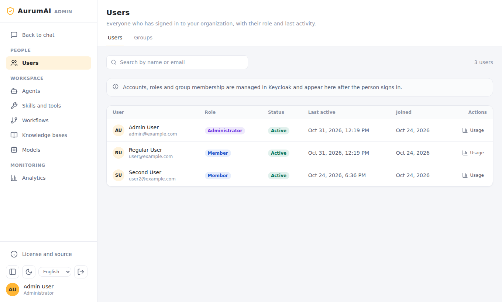
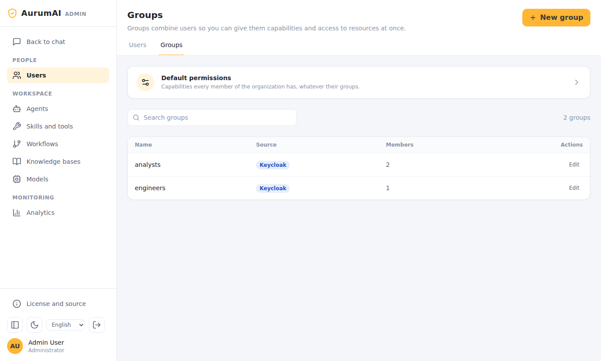
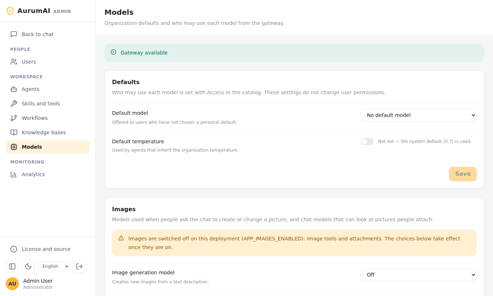
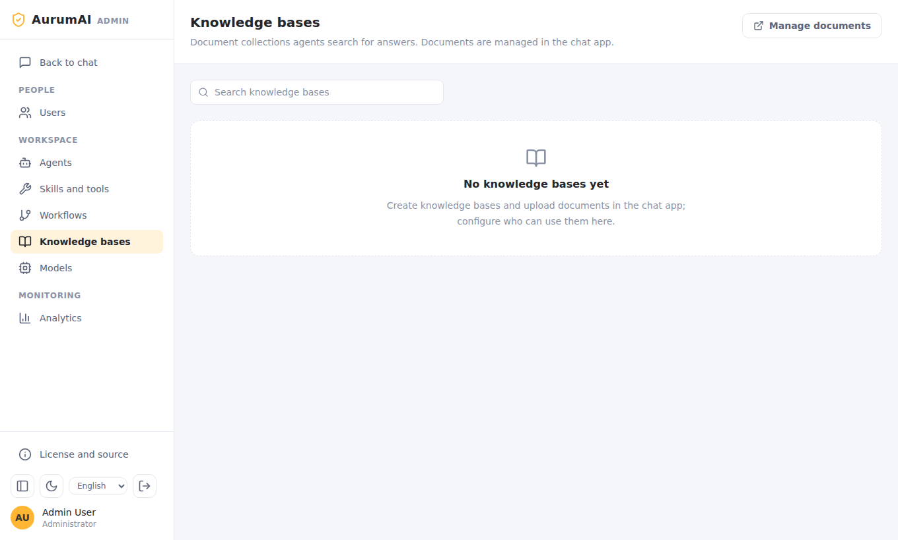
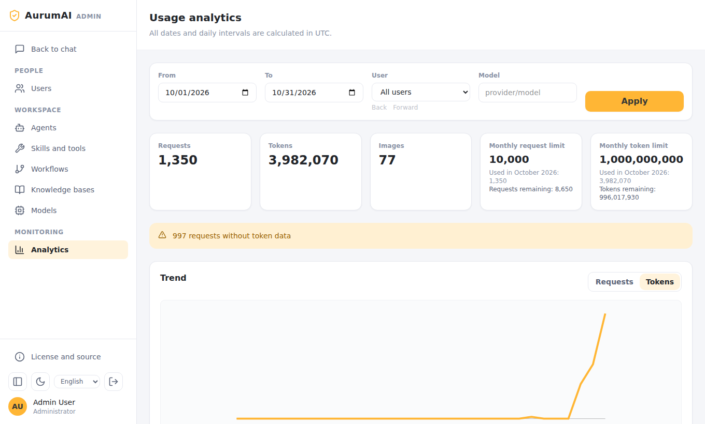

# Administrator guide

This guide is for people who run an AurumAI organization day to day: who may do what,
which models and agents people get, and how to watch usage. Installing the platform
is covered in [Installation and deployment](deployment.md); running it in production
in [Operations](operations.md).

## The Admin app

Open the admin address (`http://localhost:3100` locally) and sign in with an account
that has the `org_admin` role in Keycloak. People without it cannot enter. The sidebar
has three groups:

- **People**: Users, Groups
- **Workspace**: Agents, Skills and tools, Workflows, Knowledge bases, Models
- **Monitoring**: Analytics



Roles, accounts and group membership live in **Keycloak**
(`http://localhost:8080` locally). The Admin app shows them after a person signs in
but does not edit them. Membership is synchronised from the `groups` claim on every
sign-in, so change it in Keycloak.

## How access works

Access is **default-deny** and has two layers.

1. **Capabilities** say what a person may do:

   | Capability | Allows |
   |---|---|
   | `chat.send` | Start and continue conversations (the only default for a new organization) |
   | `workspace.agents.create` | Create agents |
   | `workspace.knowledge.create` | Create knowledge bases and upload documents |
   | `workspace.skills.create` | Add skills |
   | `sharing.manage` | Grant others access to resources (also needs the administrator role) |
   | `web.access` | Use web search and read |
   | `images.generate` | Create and edit images |
   | `agents.hermes` | Use Hermes Agent |
   | `admin.users.read`, `admin.users.write` | View and manage users |

2. **Resource grants** say which models, skills, knowledge bases, agents and workflows
   a person or group may use. Without a grant the resource is invisible to them.

Both layers are evaluated live: a change applies to the next request, including
turns already running.

### Groups and default permissions



**Users → Groups** lists groups synchronised from Keycloak. Open **Default
permissions** to set capabilities every member has, whatever their groups. Open a
group to give its members more on top of those defaults. Turn a capability on only
when you want everyone it covers to be able to add something other members then
see (an agent, a skill, a knowledge base).

Before you save a change, the preview shows the effective result for a user or group.

### Resource access

Each agent, skill, workflow, knowledge base and model has an **Access** action. Grant
it to users or groups there. Granting a model or skill to a group is how you decide
what a team can use; the person still needs the capability for the action itself.

New organizations are provisioned on the first login with the default capability and
grants for the global skills and models. For existing organizations preview and apply
provisioning from the backend container:

```bash
docker compose exec backend python -m src.cli.provision_org --all           # preview
docker compose exec backend python -m src.cli.provision_org --all --apply
```

## Models



**Models** lists what the gateway publishes. The status bar says whether the gateway
is reachable.

- **Defaults.** The default model offered to users who have not chosen one, and the
  default temperature for agents that inherit the organization's value (unset means
  the system default, 0.7).
- **Access.** Who may use each model, set in the catalog (see
  [Resource access](#resource-access)). The defaults above do not change permissions.
- **Images.** The image generation and image editing models (separate settings; either
  may be off), and which chat models accept pictures ("Models that accept images").
  People also need `images.generate`, and the operator must have set
  `IMAGES_ENABLED`; the page warns when the switch is off.
- **Hermes Agent.** The model Hermes runs on and its internet access mode. See
  [Hermes Agent: administration](hermes-agent.md#administration).

## Agents

**Agents** are assistants with a model, instructions, allowed skills and knowledge
bases, offered to users in chat. Create, edit and delete them here; people with
`workspace.agents.create` can create their own. An agent works only with the skills
and knowledge bases it has been granted, and a person using it must be granted the
agent itself.

Agent kinds include ordinary agents and, when Hermes Agent is on, an agent that runs on
Hermes (usable as a workflow node, marked with a **Hermes Agent** badge).

## Skills and tools

**Skills and tools** are what agents and chat can call:

- **MCP** servers: tools over an SSE endpoint (use *discover tools* when adding one).
  Tenant MCP uses SSE only.
- **Code** skills: an uploaded bundle that runs in an isolated sandbox over several
  rounds. They need the `skills-exec` profile on the deployment.
- **Tool** and **Agent** entries.

Use **Access** to grant each to people or groups. The page also lists skills Hermes
Agent wrote (see [Reviewing skills Hermes wrote](hermes-agent.md#reviewing-skills-hermes-wrote)).

`./install-platform.sh --apply` installs four starter tools; see
[starter tools](../STARTER_TOOLS.md).

## Workflows

**Workflows** describe multi-step processes: agents on connected nodes, with branches,
parallel steps, human approval and bounded loops. An editor guides you through five
steps, with runnable **Examples**, **Saved templates** and **Run diagnostics** tabs.
The full walkthrough, with three complete examples, is in the
[workflow guide](../WORKFLOWS.md). Workflows are versioned; a running turn keeps the
version it started with. People run workflows from the workflow picker in chat, so
grant them access to each one.

## Knowledge bases

Documents are uploaded and managed in the chat app (users with
`workspace.knowledge.create`). The Admin app's **Knowledge bases** page decides **who
can use** each one.



## Usage and quotas



**Analytics** shows requests, tokens and images for a date range (UTC), filtered by user
or model, with a daily trend. The cards show the organization's monthly request and
token limits, how much is used in the current month and what remains. Defaults are
10 000 requests and 1 000 000 000 tokens per UTC calendar month. When either runs out,
new requests are refused until the month changes. Requests whose provider reported no
token data are counted separately and flagged on the page.

Per user, **Users → Usage** opens the same report for one person. Image calls count
against the quota too. In addition each user is rate-limited
(`APP_RATE_LIMIT_PER_MINUTE`, 300; `APP_RATE_LIMIT_PER_MINUTE_STREAM`, 30).

## A first-day checklist

1. Sign in to the Admin app. Check **Models** shows *Gateway available*.
2. Choose a default model and decide which groups may use which models.
3. In **Groups → Default permissions** keep `chat.send` and add only what everyone
   should have.
4. Create the first agents; grant them to the people who should see them.
5. Add skills or knowledge bases as needed and grant access.
6. Turn on optional features in the deployment and grant their capabilities to the
   right groups: web, images, [Hermes Agent](hermes-agent.md).
7. Watch **Analytics** during the first week.
