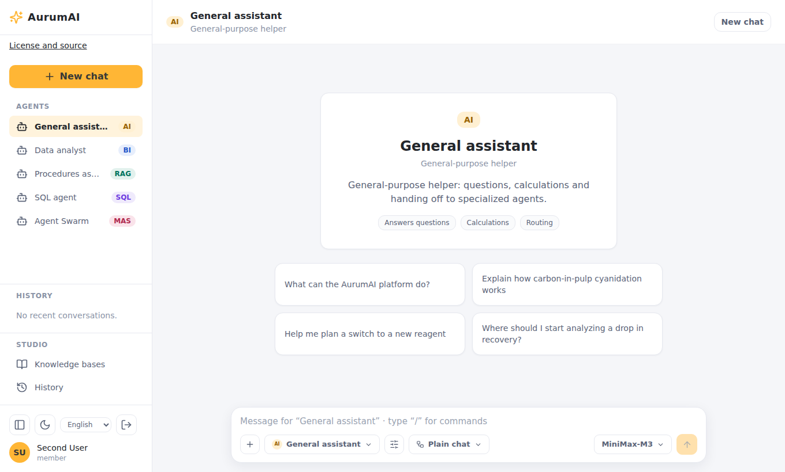

# Installation and deployment

This guide gets AurumAI running and shows where each optional feature is switched
on. Two supported ways exist:

| Method | Use for | Runtime isolation |
|---|---|---|
| Docker Compose | Local evaluation, development, a trusted single host | The backend holds Docker-socket authority |
| Helm (`charts/aurum-ai`) | Production on Kubernetes | Namespace-scoped RBAC and network policies |

Hermes Agent runs on both: as containers with the Compose overlay, as Pods with the
chart's `hermes` block (see [Hermes Agent on Kubernetes](#hermes-agent-on-kubernetes)).
For every environment variable see the
[configuration reference](../CONFIGURATION.md).

## Docker Compose

### Requirements

Docker with Compose v2, Bash and OpenSSL. Free ports 3000, 3001, 3100, 8000, 8001,
8080 and 8082; the Compose file also uses loopback ports for infrastructure. Plan for
about 8 GB of free RAM and 15 GB of disk for the base stack; optional RAG models and
build caches need more.

### Install

```bash
git clone https://github.com/tsrman/AurumAI.git && cd AurumAI
./scripts/bootstrap-dev-env.sh                   # creates .env with generated secrets
docker compose --profile build build runner     # image the backend starts per conversation
docker compose up -d --build
curl --fail http://localhost:8000/ready
```

`bootstrap-dev-env.sh` creates the ignored `.env` from `.env.example`, generates the
required secrets and keeps values you already set when you run it again. Never commit
`.env`. Building the runner is required: the backend starts one container from it for
each conversation.

Keycloak and Temporal take longer to initialise than the APIs. A passing `/ready` does
not prove optional features are ready; check `docker compose logs` for the component
that is failing.

| Address | What |
|---|---|
| `http://localhost:3000` | Chat app |
| `http://localhost:3100` | Admin app |
| `http://localhost:8000`, `:8001` | Business and Admin APIs |
| `http://localhost:8080` | Keycloak |
| `http://localhost:8082` | Temporal UI |
| `http://localhost:3001` | Langfuse |

Log in at the chat address as `user` / `user`, or at the admin address as `admin` /
`admin`; `user2` and `admin2` belong to a second organization. These development
accounts are realm fixtures: replace them before real use.

With `APP_DEBUG=true` and no model gateway configured, answers come from a
development mock. That still exercises login, API, Temporal and the conversation
runner.



### Connect a real model

Any OpenAI-compatible gateway works. In `.env`:

```dotenv
LLM_GATEWAY_URL=https://gateway.example.org   # base URL without the final /v1
GATEWAY_API_KEY=operator-supplied-key
```

Recreate both API planes afterwards (`docker compose up -d --force-recreate backend backend-admin`).
Then open **Models** in the Admin app: the gateway's models appear there and you decide
who may use them (see the [administrator guide](admin-guide.md#models)).

`./start-with-llm-gateway.sh` starts an optional local Bifrost gateway for OpenRouter
(`OPENROUTER_API_KEY`). The runner always calls the backend's proxy with its own
session token, so authorization and quota apply.

### Optional features

| Feature | How to turn it on |
|---|---|
| Starter tools (CSV statistics, JSON formatting) | `./install-platform.sh --apply` (a dry run without `--apply`) |
| Code skills | `docker compose --profile build build skill-sandbox`, start with profile `skills-exec` |
| Knowledge bases (RAG) | `docker compose --profile rag up -d --build`; the first model download can take minutes |
| Questions | `USER_QUESTIONS_ENABLED=true` |
| Web search and read | `docker-compose.web.yml` with profile `web`, its secrets and enforcement checks |
| Images | `IMAGES_ENABLED=true`, then models in Admin → Models |
| Hermes Agent | See [Hermes Agent: setup](hermes-agent.md#set-it-up) |
| Identity synchronization, archiving | Profile `maintenance`; see [operations](operations.md) |

Each switch is off by default and independent. Capabilities are default-deny, so a
feature also needs its capability granted to the people who should use it (Admin →
Users → Groups).

### Publish on the internet

`docker-compose.proxy.yml` adds Traefik with Let's Encrypt and publishes only ports 80
and 443:

| Host | Service |
|---|---|
| `chat.<domain>` | Chat app |
| `admin.<domain>` | Admin app |
| `api.<domain>`, `admin-api.<domain>` | Business and Admin APIs |
| `auth.<domain>` | Keycloak |
| `temporal.<domain>` | Temporal UI behind basic auth |
| `langfuse.<domain>` | Langfuse |

Point DNS at the host, set `PUBLIC_DOMAIN` and `ACME_EMAIL` in `.env`, run
`./scripts/bootstrap-dev-env.sh` (it generates the Temporal UI password), then:

```bash
docker compose -f docker-compose.yml -f docker-compose.proxy.yml up -d --build
```

On an existing Keycloak database add `https://chat.<domain>/*` and
`https://admin.<domain>/*` to the `business-ui` and `admin-ui` clients yourself; the
realm import runs only on a fresh database. Use
`ACME_CA_SERVER=https://acme-staging-v02.api.letsencrypt.org/directory` while testing
DNS. Do not widen `PUBLIC_BIND_ADDRESS` instead of using the proxy: Docker-published
ports bypass host firewalls.

### Production checklist

- Replace the development accounts and set real secrets; set `APP_DEBUG=false`
  (it also hides the API's `/docs`).
- Terminate TLS and set the Keycloak redirect origins to your real hosts.
- Set `RUNTIME_SOURCE_CODE_URL` to where users can get the source of your deployment
  (AGPL), shown on each app's `/about` page.
- Compose gives the backend root-equivalent Docker-socket authority. Never expose it
  to untrusted clients; use Helm when you need stronger isolation.
- Keep code execution, MCP and public web behind their opt-in policies. Do not open
  outbound network access to make a failing check pass.
- Decide deliberately whether Langfuse captures full prompts and documents.
- Back up PostgreSQL, MinIO and the `.env` secrets (see [operations](operations.md)).

## Kubernetes with Helm

The chart deploys the two APIs, both apps, tool-worker and skill-executor. The API starts
one runner Pod per conversation; skill-executor starts a sandbox Pod per code session.
PostgreSQL 16 (with pgvector and pg_partman), Redis, Keycloak, Temporal, MinIO, the RAG
API and Langfuse are **external**: you supply their endpoints.

Requirements:

- Kubernetes, Helm 3, kubectl and a CNI that actually enforces NetworkPolicy.
- Three different namespaces for the release, the runners and the sandboxes. The chart
  rejects coinciding namespaces.
- Registry images (`ghcr.io/tsrman/aurum-ai-*`, tagged per release) and pull secrets in
  every namespace that needs them; Helm does not copy secrets between namespaces.
- Explicit external CIDRs and ports. The development private-range defaults are not a
  production allowance.

```bash
helm lint charts/aurum-ai -f values-production.yaml
helm template aurumai charts/aurum-ai -n aurumai -f values-production.yaml | kubeconform -strict -summary
helm upgrade --install aurumai charts/aurum-ai -n aurumai --create-namespace -f values-production.yaml --wait
```

Migrations run through a dedicated hook and role, not on every API replica's startup.
Browser origins derive from the configured Ingress unless you override them. The
[chart guide](https://github.com/tsrman/AurumAI/blob/main/charts/aurum-ai/README.md)
covers secret ownership, workflow and feature rollout, and acceptance checks.

### Hermes Agent on Kubernetes

Hermes is off by default. To turn it on, give it its own namespace and secrets:

```yaml
hermes:
  enabled: true
  namespace: aurumai-hermes          # not the release, runner, sandbox or web namespace
  egress:
    maxMode: packages                # none | packages | public
    existingSecret: hermes-egress    # HERMES_EGRESS_SERVICE_SECRET, in BOTH namespaces
    serviceSecret: ""
    secretRotationToken: "1"
  sandbox:
    runtimeClassName: ""             # a RuntimeClass whose nodes set a PID limit
```

The chart then deploys the namespace (Pod Security `restricted`), the `hermes-egress`
guard and default-deny NetworkPolicies in which a sandbox reaches only the guard, plus
the Role that lets skill-executor create sandbox Pods. Requirements beyond the base
chart:

- A CNI that enforces **egress** NetworkPolicy (k3s's built-in controller was checked).
  Without enforcement the boundary does not exist.
- The `aurum-ai-hermes-sandbox` image (about 2.5 GB) in your registry, and its pull
  secret in the Hermes namespace (`skillSandbox.imagePullSecrets` names it).
- One skill-executor replica, a `sandboxRuntime.type` of `kubernetes` and the
  `web.networkPolicy` exclusion lists intact: Hermes reuses them as its list of private
  ranges.
- `internalPackageHosts` and `internalDestinations` together, if sandboxes should reach an
  internal package mirror: NetworkPolicy knows addresses, not names. A mirror inside the
  cluster is described by the address of its Pod, **not of its Service**: the policy sees
  the Pod after the Service's translation, so an entry for the Service address lets nothing
  through. A mirror outside the cluster is described by its own address.
- Kubernetes has no per-Pod process limit. Point `hermes.sandbox.runtimeClassName` at a
  RuntimeClass whose nodes set one, or accept the limit of the node.

For previews set `hermes.preview.enabled`, `origin` (for example
`https://{preview}.preview.example.org`) and `host` (`*.preview.example.org`); the chart
adds the preview service, its secrets and a wildcard Ingress rule for it. Use a domain
that is not the platform's and not under it (see the
[security model](../reference/security.md#previews)), and terminate a wildcard certificate
at the Ingress. The [Hermes guide](hermes-agent.md#set-it-up) covers the rest, and
`./smoke-test-hermes-k8s.sh` is the acceptance run on a disposable k3d cluster.

## Air-gapped installation

[Air-gapped deployment](../AIR_GAPPED.md) describes preparing images and models outside
the boundary and building and verifying inside it.

## Images

Service images are published to `ghcr.io/tsrman/aurum-ai-*` for each release by the
`publish images` workflow. A package published for the first time may be private until
its visibility is changed in the GitHub package settings.
