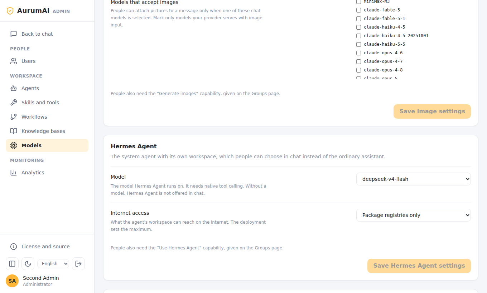
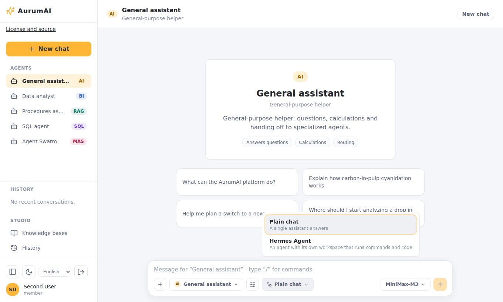
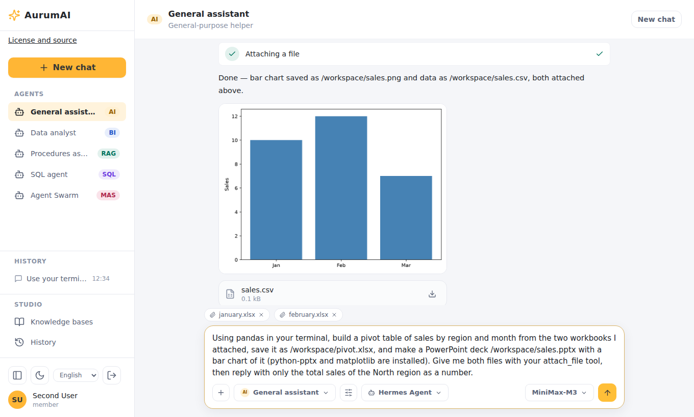

# Hermes Agent guide

Hermes Agent is an opt-in system agent. Instead of a single answer from a model, it
gets a workspace of its own, a long-lived sandbox where it runs commands and code,
keeps files between turns and reports back. Use it for tasks that need work, not just
text: analysing spreadsheets, producing documents and charts, building and testing a
small web app.

This guide covers how to set it up, how people use it and how administrators manage
it. The settings reference is in [configuration](../CONFIGURATION.md#hermes-agent); the
design and its reasoning in the [design document](../HERMES_AGENT.md).

## What it can do

- **Run commands and code** in its own sandbox. The image has Python (pandas,
  matplotlib, openpyxl, python-pptx, python-docx, pypdf), Node.js 24 with npm, a
  headless Chromium and Playwright.
- **Work on your files.** Files you attach appear in `/workspace/inputs/` in its
  sandbox, with stable numbered names.
- **Hand files back.** Charts, spreadsheets, documents, presentations and archives
  appear in the answer as downloads; pictures show under the answer.
- **Use platform tools** through a bridge: knowledge search, web search and read,
  image generation and editing, skills it is granted, and questions to you.
- **Look at pictures** when the organization marks its model as taking images.
- **Remember** notes about you across conversations, which you can clear.
- **Write skills** for itself that an administrator reviews before anyone else can use them.
- **Show you what it builds.** It starts an app in the background and shares it; an
  **Open prototype** card appears in the answer.
- **Be a workflow node**, running inside a larger workflow.

## Set it up

On Docker you need version 28 or newer on the host: every sandbox gets its own internal
network. On Kubernetes see [Hermes on Kubernetes](deployment.md#hermes-agent-on-kubernetes)
instead of steps 1 and 2 below; steps 3 and 4 are the same.

1. Create the secrets. In `.env`:

   ```dotenv
   HERMES_ENABLED=true
   HERMES_EGRESS_SERVICE_SECRET=<a long random value>
   HERMES_EGRESS_MAX_MODE=packages        # none | packages | public
   ```

   `HERMES_EGRESS_MAX_MODE` is the most internet any organization can give its
   sandboxes. `packages` allows only package registries (`HERMES_EGRESS_PACKAGE_HOSTS`:
   PyPI and npm by default).

2. Build the sandbox image (about 2.4 GB) and the runner, then start the stack with the
   overlay and profiles:

   ```bash
   docker compose -f docker-compose.yml -f docker-compose.hermes.yml --profile build build hermes-sandbox runner
   docker compose -f docker-compose.yml -f docker-compose.hermes.yml \
     --profile hermes --profile skills-exec up -d --build
   ```

3. The model gateway must forward **native tool calls**, and the model you give Hermes
   needs tool calling.

4. In the Admin app (see [Administration](#administration)), choose Hermes's model and
   grant the `agents.hermes` capability to the right group.

Hermes needs `tool-worker` and `skill-executor` running (`skill-executor` is in the
`skills-exec` profile on Compose, and part of the chart on Kubernetes).

### Previews of running apps (optional)

Previews let a person open an app Hermes is running. They are off until you give them
their own origin:

```dotenv
HERMES_PREVIEW_ENABLED=true
HERMES_PREVIEW_ORIGIN=https://{preview}.preview.example.org
HERMES_PREVIEW_SERVICE_SECRET=<random>
HERMES_PREVIEW_EXECUTOR_SECRET=<random>
```

Start the `hermes-preview` profile as well. The service listens on
`HERMES_PREVIEW_PORT` (8095) and must be reachable at the origin template, so it needs a
**wildcard DNS record and a wildcard TLS certificate** for it, terminated in front of
the service. Use a domain that is **not** the platform's own and not a subdomain of it:
a preview runs agent-written code in the viewer's browser, and a page on a shared
parent domain can set cookies for that parent. See the
[security model](../reference/security.md#previews).

On Kubernetes the chart's `hermes.preview` block does the same and adds a wildcard
Ingress rule. For local trials with Compose set the origin to
`http://{preview}.preview.localhost:8095`, which browsers resolve to the machine itself. Connection limits and timeouts are in the
[configuration reference](../CONFIGURATION.md#hermes-agent).

## Administration

Everything is in the Admin app.



- **Models → Hermes Agent.**
  - *Model*: what Hermes runs on. Without one, Hermes is not offered in chat. The model
    must be one the organization may use.
  - *Internet access*: **None**, **Package registries only** or **Public internet**,
    within the deployment's maximum; a mode above the maximum is shown as such and refused.
- **Users → Groups.** Grant `agents.hermes` to the people who should have it. Nobody
  has it by default.
- **Workflows and Agents.** A Hermes Agent can be a workflow node ("Hermes Agent
  (workflow nodes)" kind) and runs on the organization's Hermes model.

If the page says Hermes is switched off on this deployment, `HERMES_ENABLED` is not set.

### Reviewing skills Hermes wrote

Hermes can write skills for itself while it works. Each lands in **Skills and tools →
Skills Hermes Agent wrote** as a draft for the person it was written for. **Review**
shows every file as written. **Nothing in it runs until you approve it.** Approving
makes it a code skill of the organization that its author can use; you grant it to
others as for any skill. **Decline** rejects it. Read every file: it is code.

### Limits

| Limit | Default |
|---|---|
| Sandboxes running at once | 16 in total, 4 per organization |
| Sandbox resources | 2 CPUs, 2 GiB memory, 512 processes, 1 GiB workspace |
| Idle sandbox | Stopped after 30 minutes; the workspace is snapshotted |
| Session lifetime | 24 hours |
| Skill run | 240 seconds per call |
| Files handed back | 10 per turn, 20 MiB each |

Limits are settings of the deployment; the names are in the
[configuration reference](../CONFIGURATION.md#hermes-sandboxes).

## Using it

1. In the chat, open the workflow picker and choose **Hermes Agent**.

   

2. Describe the task. Attach files with **+** or by dragging them in (up to 10 per
   message, 20 MiB each; spreadsheets, documents, code, text, ZIP and PNG, JPEG or WebP
   pictures; at most 20 uploads and 200 MiB per conversation).
3. Watch the tool rows: commands it runs appear by kind, not their output.
4. When it asks you something, a question card appears; answer to continue.
5. Download what it produced from the answer. Pictures show under it.

   

A conversation with Hermes keeps its workspace between messages, so follow-ups can
build on earlier files.

### Example: pivot table and a presentation

Attach several `.xlsx` files and ask: *"Combine these workbooks into one pivot table
by region and month in a new workbook, and make a short presentation with charts."*
Hermes reads the files from its inputs folder, builds the workbook with `openpyxl` or
pandas, draws charts with matplotlib, writes a `.pptx` with `python-pptx` and attaches
both.




### Example: a web app prototype

Ask: *"Build a prototype of a task tracker web app, check that it works, and give me the
code with instructions to run it."* Hermes scaffolds the app with Node.js, runs it,
checks it in a headless browser, and returns a ZIP with the code, a README and
screenshots. With previews enabled it also shares the running app: an **Open prototype**
card opens it in a new tab at an origin of its own.


### Memory and your skills

**Settings → Hermes Agent memory** shows what Hermes keeps about you; **Clear
memory** erases it. **Settings → Hermes Agent skills** shows the skills it wrote for
you and their review status, and lets you withdraw one (see the
[settings screenshot](user-guide.md#settings)).

## Network and safety in short

- The sandbox has **no route** to your network or the internet except through the
  platform's egress guard, which allows the platform itself and, up to the mode the
  organization chose, the registries or the internet.
- Its credentials are a short-lived token that names a person only; no model-provider
  key is in the sandbox.
- A preview needs a ticket that opens once and a cookie that is valid for one preview,
  and the service re-checks it continuously; ending the session cuts it.

Details: [security model](../reference/security.md#hermes-agent).

## Troubleshooting

| Symptom | Likely cause |
|---|---|
| Hermes Agent is not in the picker | `HERMES_ENABLED` is off, no model chosen under Models → Hermes Agent, or the user lacks `agents.hermes` |
| It cannot install packages | Mode is **None**, or the registry is not in `HERMES_EGRESS_PACKAGE_HOSTS` |
| The turn fails at the start | The sandbox image is not built, `skill-executor` is not running, or the 16/4 concurrent limit is reached |
| It cannot reach a website | Mode is not **Public internet** |
| Pictures are ignored | The model is not marked as accepting images (Models → Images) |
| *Open prototype* does nothing | Previews are off, the wildcard DNS or TLS is wrong, or the service secrets differ |
