# User guide

This guide is for people who use AurumAI in the chat app: asking questions,
working with documents, and handing tasks to agents. Administrators who set the
platform up should read the [administrator guide](admin-guide.md).

What you can do depends on what your administrator turned on. If a picker, a
button or a page described here is missing, your organization has not enabled it or
you have not been given access (see [Access](#what-you-can-see)).

## Sign in

Open the chat address your administrator gave you (`http://localhost:3000` on a
local installation) and choose **Sign in with Keycloak**. Accounts, passwords and
group membership are managed by your administrator in Keycloak; the platform does
not store passwords.

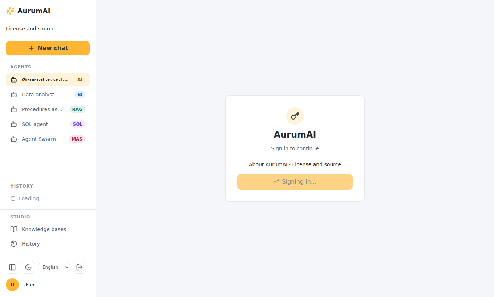

A local development installation ships with `user` / `user` and `admin` / `admin`
accounts. They are for evaluation only.

The language of the interface follows your browser (English or Russian). The
language switcher at the bottom of the sidebar remembers your choice. The
assistant's own answers are not translated: they follow the language you write in.

## The chat window

- **Sidebar.** **New chat** starts a conversation. **Agents** lists the ordinary chat and
  the agents your administrator created and granted to you, each with its own model,
  instructions, tools and knowledge.
  **History** lists your recent conversations. **Knowledge bases** and **History** below it
  open the pages of the same name. At the bottom are the sidebar toggle, the theme
  switch, the language switcher and sign-out.
- **Composer.** Type a message and press Enter to send it (Shift+Enter adds a line;
  you can turn Enter-to-send off in [Settings](#settings)). The placeholder says
  you can type `/` for commands.
- **Pickers under the text box.** From left to right: the **agent**, **model
  settings** (temperature for this conversation), the **workflow or Hermes Agent**
  picker, and the **model**.

The assistant streams its answer. While it works you may see a thinking box, tool
rows (what it is calling) and, with web search on, source citations. **Stop**
cancels the answer in progress. If the page is reloaded or the connection drops, the
conversation catches up from the server.

If a turn fails, the reason stays in the history, set apart from answers, with a way
to try again.

### Choosing a model

The model picker lists the models your administrator has made available to you.
Your choice applies to the conversation. Without a choice, your default from
[Settings](#settings) is used, then the organization's default.

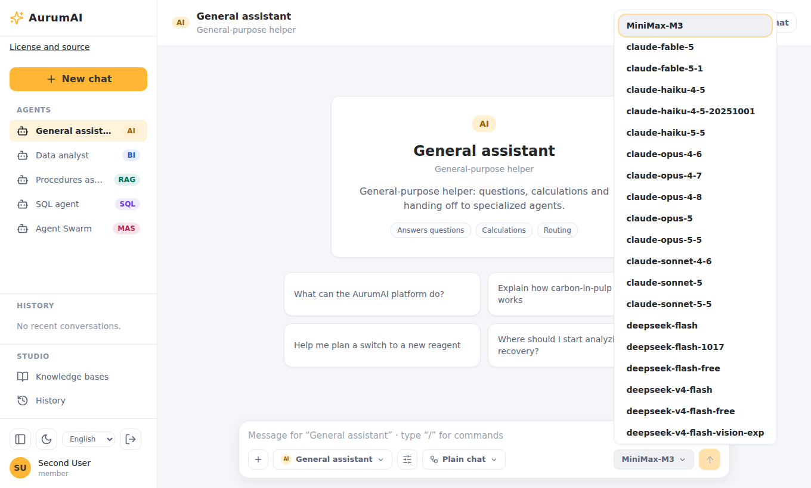

**Model settings** (the sliders button) sets the temperature for this conversation
only. By default the agent's or organization's value is used.

### Agents

An agent is a model with instructions, allowed tools and knowledge bases, created by an
administrator (see the [administrator guide](admin-guide.md#agents)). Pick one in the
sidebar or the agent picker, then write as usual:

- The turn runs on the agent's model and instructions, and the agent has only the skills
  and knowledge bases it was given. Web search and image tools are off for it. The model
  picker shows the agent's model and cannot change it.
- The agent stays chosen for the conversation, also after a reload. Choosing a workflow or
  Hermes Agent for a turn replaces the agent for that turn.
- You see only agents granted to you. An agent that was archived or whose access was
  withdrawn disappears from the list, and an open conversation goes back to the ordinary chat.
- The temperature you set for the conversation wins over the agent's own value, which wins
  over the organization's.

### Workflows

A workflow is a repeatable multi-step process several agents carry out: a supervisor
prepares tasks, agents work on connected steps, and the supervisor combines their
results into one reply. Choose one in the workflow picker (default **Plain chat**,
where a single assistant answers). While it runs you see a progress card; some
workflows pause and ask you to **approve** a step, and you can cancel a run.

Your organization may also let the platform choose a workflow for you when you
send an ordinary message; that choice is opt-in, and picking **Plain chat** explicitly
is never overridden.

### Questions from the assistant

When the organization has durable questions enabled, the assistant can ask you
something it needs to continue. The question appears as a card in the conversation
with options or free text. Answer it to continue; the composer asks you to answer
the question above first. A question times out after an hour by default, and one
turn can ask at most ten questions with four open at a time.

### Web search

When web access is on and you have the capability, the assistant can search the
web and read pages. Answers cite their sources; open the source list to see them.
Per turn, at most 10 searches and 20 page reads are allowed by default.

### Images

With image tools on and the capability granted, ask the assistant to create or
change a picture in plain words. Pictures appear under the answer and can be
downloaded. Up to four images are created per turn, and a later message can edit
an earlier picture.

You can attach pictures to a message (PNG, JPEG or WebP, up to 10 MB each and four
per message) when the model you picked takes images. If it does not, the composer
tells you to pick a vision model or remove the pictures.

### Attaching documents

Use the **+** button, or drag files onto the composer, to attach PDF, DOCX, PPTX,
HTML, Markdown or text files (up to 25 MB each). The attachment shows
*processing*, then *ready* once it has been parsed and indexed, and the assistant
can use it in that conversation. An attachment marked *error* could not be processed.

## Knowledge bases

Knowledge bases are collections of documents that agents search for answers (rules,
procedures, documentation). Open **Knowledge bases** in the sidebar.

- **Create knowledge base** (needs the *create knowledge bases* capability), then drag
  files in or choose them. Accepted: PDF, DOCX, PPTX, HTML, MD and TXT, up to 25 MB.
- Each document shows its type, size, chunk count and status: *Indexing…*,
  *Indexed* or *Error*. A document is searchable once it is indexed.
- **Search the knowledge base** tests what an agent would find, with a relevance
  score for each result.
- Who may use a knowledge base is set by an administrator (see
  [administrator guide](admin-guide.md#knowledge-bases)). Agents can search only the
  knowledge they are granted.

## Hermes Agent

If your organization has enabled it, **Hermes Agent** appears in the workflow
picker ("An agent with its own workspace that runs commands and code"). It can
work on files you give it, produce spreadsheets, documents, presentations and
charts, and build web app prototypes you can open. Read the
[Hermes Agent guide](hermes-agent.md).

## Examples

These are real runs on a development installation with a hosted model
(`deepseek-flash-1017` for ordinary chat, `deepseek-v4-flash` for Hermes Agent). Your
answers will differ in wording, and what you can do depends on the model and on what your
administrator has turned on.

### Compare options and get a recommendation

Ask for a structure, not an essay:

> Compare PostgreSQL, MySQL and SQLite for a small team's internal tool. Give a short
> table (criteria: setup effort, concurrency, backups, best for) and a one-line recommendation.

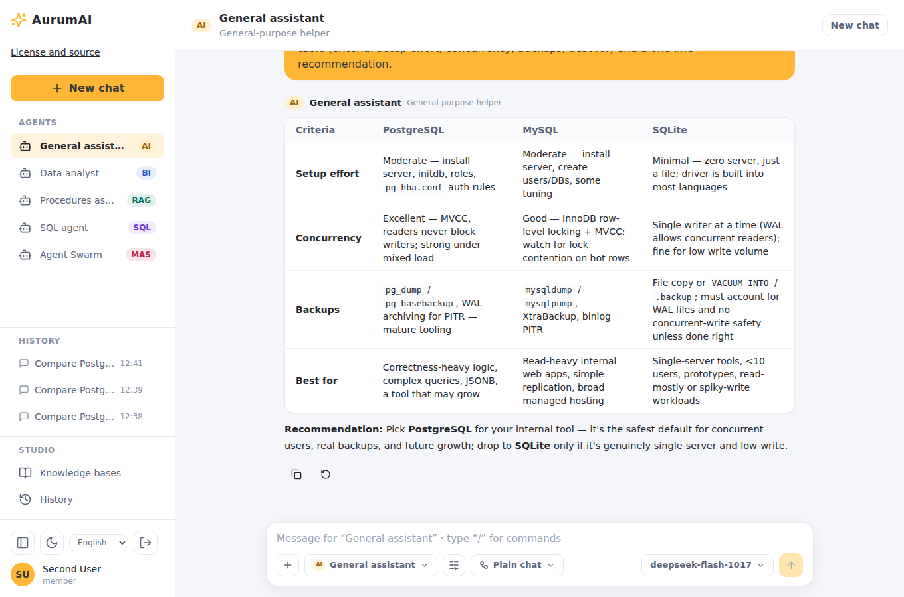

Tables, code and lists are rendered in the answer, and **Copy** puts the Markdown on your
clipboard. Follow up in the same conversation ("Make it for a team of 50", "Add cost") and the
assistant keeps the context.

### Turn rough notes into action items

Paste unstructured text and say what shape you want back:

> Turn these rough meeting notes into action items with an owner and a due date each, as a
> table: 'Anna to check the vendor contract before Friday. Ravi will draft the launch email,
> needs legal review first, aim for next Tuesday. Someone should book the demo room for the
> 14th. Dana owns the pricing page update, two weeks.'

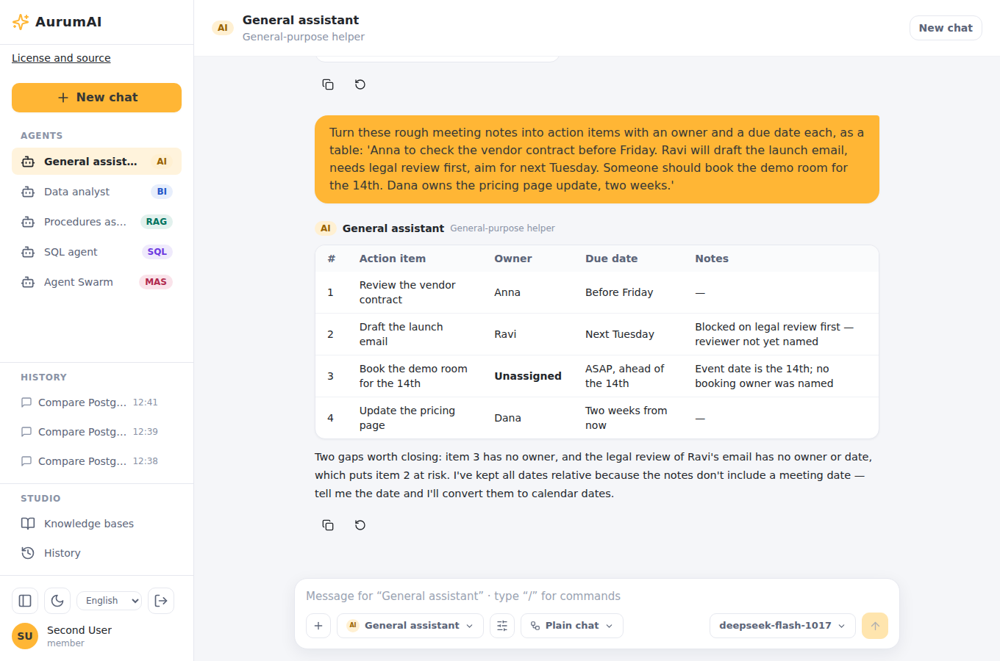

Note what the assistant did beyond formatting: it marked the item nobody owns as
*Unassigned*, pointed out that the legal review has no owner or date, and kept dates relative
because the notes carry no meeting date. Check such answers against your source.

### Draw a diagram

Diagrams written in Mermaid are drawn in the answer:

> Draw a mermaid flowchart of how a support ticket moves from creation to resolution, including
> escalation to a second line. Use only simple node labels without parentheses. Output only the
> diagram in a mermaid code block.

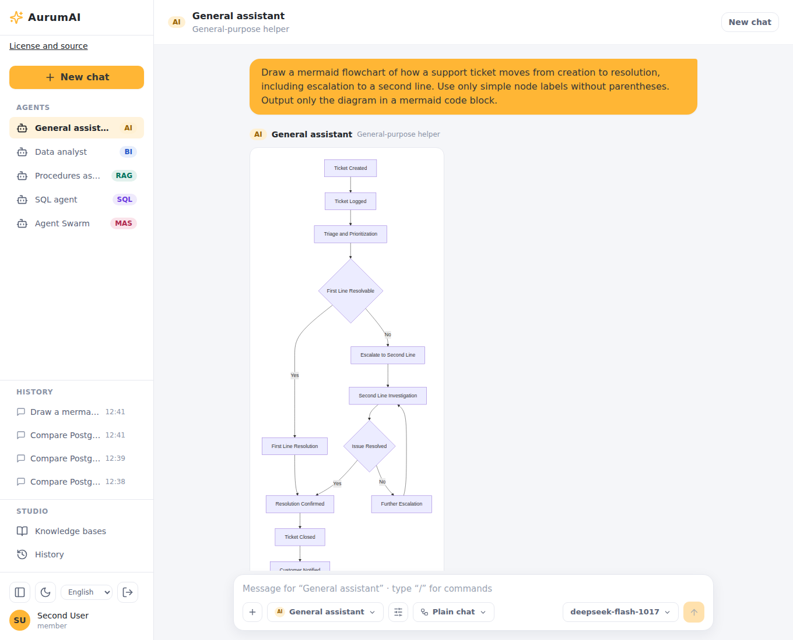

Models sometimes write Mermaid that does not parse, and then the answer shows the code and the
error instead of a picture. Asking for simple labels, or pressing the retry button, usually fixes it.

### Chart and data file with Hermes Agent

With [Hermes Agent](hermes-agent.md) chosen, ask for a calculation and a picture:

> Use your terminal and Python's matplotlib to draw a bar chart of these monthly sales: Jan 10,
> Feb 12, Mar 7. Save it as /workspace/sales.png and the data as /workspace/sales.csv, then give
> me both files with your attach_file tool.

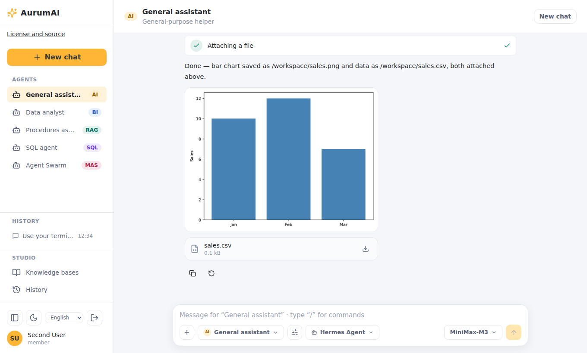

### Pivot table and a presentation from your workbooks

Attach two or more spreadsheets to a Hermes message and ask for a combined result:

> Using pandas in your terminal, build a pivot table of sales by region and month from the two
> workbooks I attached, save it as /workspace/pivot.xlsx, and make a PowerPoint deck
> /workspace/sales.pptx with a bar chart of it. Give me both files with your attach_file tool,
> then reply with only the total sales of the North region as a number.

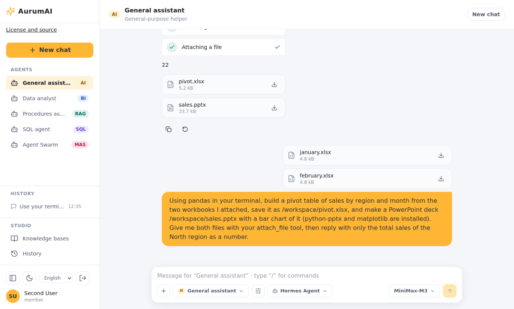

The answer is the requested number, with `pivot.xlsx` and `sales.pptx` ready to download.

### A web app prototype you can open

> Build a small Flask web app with one page that shows a list of three tasks and a form to add
> one. Test it with pytest, then start it and check the page in headless Chromium with
> Playwright, adding a task. Attach a screenshot of the page with the added task and the project
> as one ZIP with a README.md on how to run it.

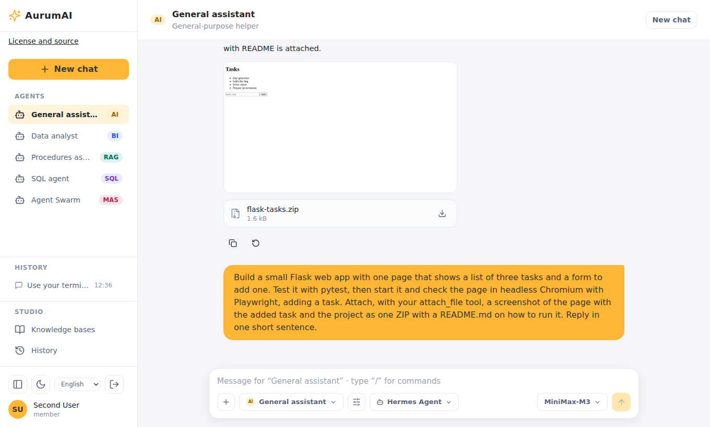

Hermes wrote the code and its tests, ran them, looked at the page in a headless browser and
handed back the project. A follow-up asks it to keep the app running and share it, and an
**Open prototype** card appears:

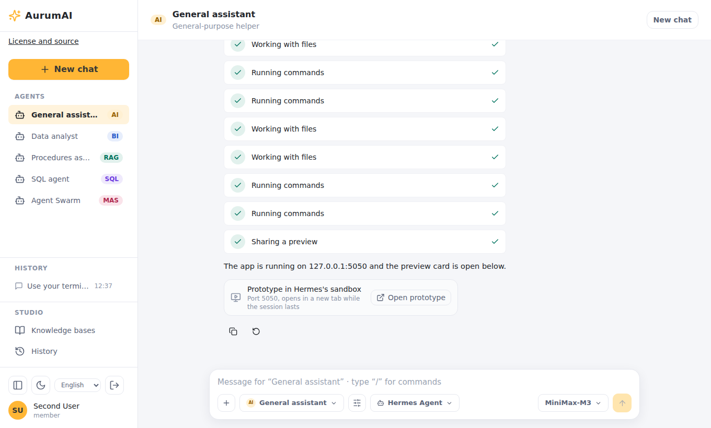

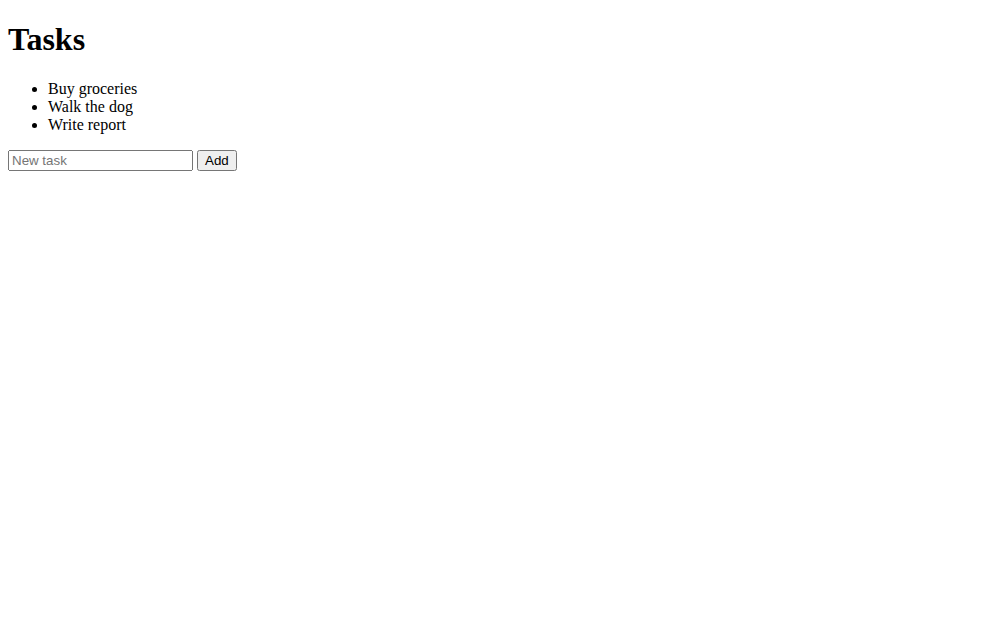

### Tips for good results

- Say the shape of the answer you want (a table, three bullets, a ZIP) and the audience.
- Put the material in the message or attach it, rather than assuming the assistant knows it.
- Ask for the check as well as the work ("test it", "name any gaps").
- Start a new chat for an unrelated task; a long conversation carries everything before it.
- Treat answers as drafts. The assistant can be wrong, and agents act with the access you have.

## History

The **History** page lists your conversations, newest first. Open one to continue it.
Conversations are private to you. Your administrator may archive old conversations under the organization's
retention policy.

## Settings

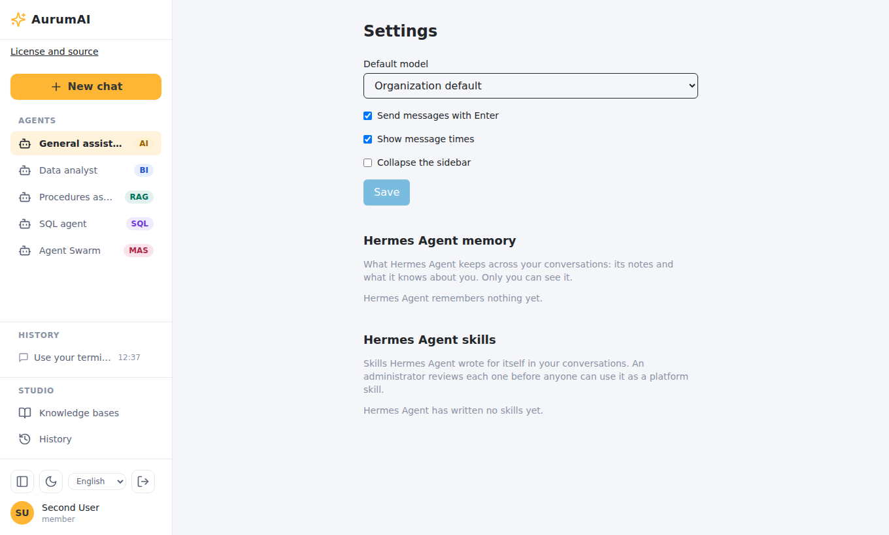

| Setting | Effect |
|---|---|
| Default model | The model for new conversations when you pick none; "Organization default" follows your administrator's choice |
| Send messages with Enter | Off means Enter adds a line |
| Show message times | Timestamps next to messages |
| Collapse the sidebar | Start with the sidebar collapsed |
| Hermes Agent memory | What Hermes keeps about you across conversations; **Clear memory** erases it |
| Hermes Agent skills | Skills Hermes wrote for itself in your conversations, with their review status; you can withdraw one |

The last two sections appear only when Hermes Agent is available to you.

## What you can see

Access is default-deny. Your organization gives you **capabilities** (what you may
do: send chat messages, create agents, knowledge bases or skills, use the web,
generate images, use Hermes Agent) and **resource grants** (which models, skills,
knowledge bases, agents and workflows you may use). Out of the box a member can send
chat messages and use what has been granted to them. If something you need is missing,
ask your administrator.

## Usage limits

Your organization has a monthly allowance of requests and tokens, counted per calendar
month in UTC. When it is used up, new requests are refused until the month changes
or an administrator raises it. Ordinary requests are also rate-limited per user (300
per minute by default, 30 per minute for chat streams); if you hit that, wait a moment.

## Privacy

Prompts, attached documents and files can be stored with your conversation and may be
visible to platform operators and, where observability capture is on, in their
monitoring tools. Do not share secrets or personal data you would not give your
administrator.
